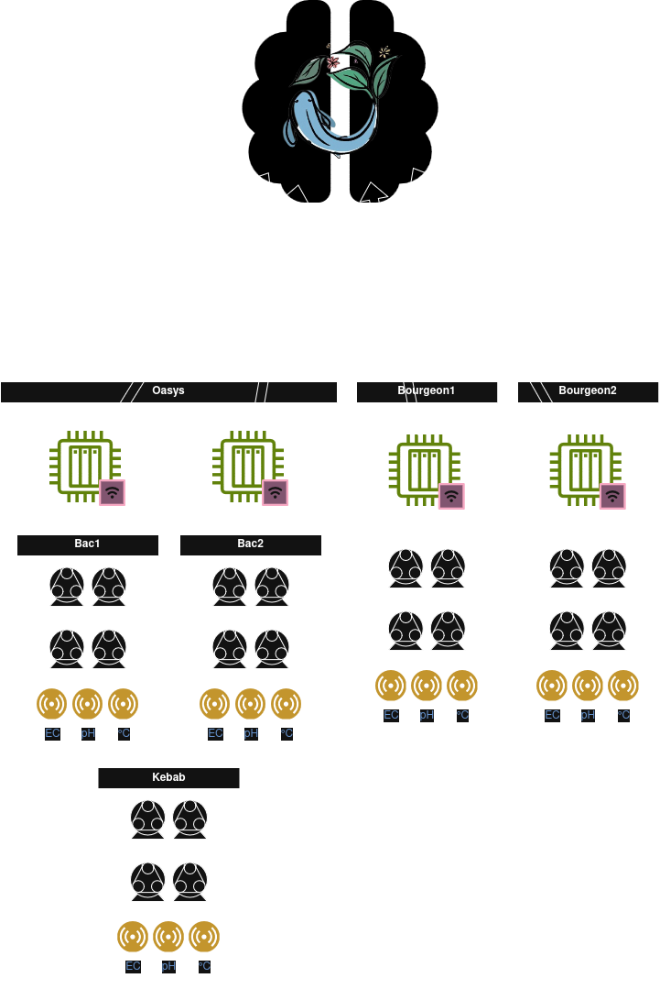

# AquaDash v3.0.0 -- Document de vision

| Auteur         | Version | Date         |
| -------------- | ------- | ------------ |
| Thierry Poulin | _v0.1_  | _2026-11-09_ |
| Thierry Poulin | _v0.2_  | _2026-11-11_ |
| Thierry Poulin | _v1.0_  | _2026-11-13_ |
| Thierry Poulin | _v1.1_  | _2026-11-18_ |

---

## 1. But du document

Ce document a pour but d'établir comment doit évoluer AquaDash au cours de la prochaine année et demie. Il couvre le problème qu'il résout, les concepts et principes clefs qu'il suit, ainsi que ce qui fait ou ne fait pas partie du plan.

Ce n'est pas une conception finale, ni même une conception tout court. L'objectif est de donner l'intention et la direction générales, et de démarrer une réflexion préalable à la conception proprement dite.

---

## 2. Contexte

### 2.1 Ce qu'est AquaDash aujourd'hui

AquaDash peut surveiller et (est en voie de pouvoir) automatiser la gestion des paramètres d'**un** système hydroponique.

Un Raspberry Pi lit un ensemble fixe de capteurs (EC, pH, température) via des « pilotes » écrits exactement pour l'arrangement des capteurs sur Oasys. Des tâches planifiées publient les lectures sur le backend d'AquaDash.

Le backend stocke les mesures. Le frontend Angular les affiche et permet aux utilisateurs de configurer des actuateurs.

Un service sur le Raspberry Pi demande par **polling** au backend si un actuateur doit être activé. Le backend décide selon la dernière mesure prise et un simple seuil.

### 2.2 Limites de la conception actuelle

#### Un seul système

Les actuateurs sont implicitement rattachés au seul système géré par AquaDash et dont les paramètres sont mesurés par les capteurs. Le modèle de données contient l'ébauche d'une notion de plusieurs systèmes (`Prototype`), mais elle n'a jamais servi: le frontend la fixe à 0. Il n'y a aucune notion du hardware qui utilise les capteurs et les actuateurs.

#### Hardware hard-codé

Les adresses de capteurs, les pins de pompes et les identifiants de dispositifs sont des constantes dans le code exécuté par le Raspberry Pi. Pour ajouter ou retirer un dispositif, il faut modifier du code.

#### Responsabilités mixtes

- Le dispositif décide quand demander une décision.

- Le backend décide s'il active.

- Le dispositif enregistre le fait qu'il a été activé.

Donc aucune composante ne possède le cycle complet: décider --> commander --> confirmer.

#### Le contrôle est primitif

Chaque actuateur compare une mesure avec une seule valeur. Il n'y a pas de notion de dose, de volume, de calibration, de temps de mélange, ou de coordination entre les actuateurs (e.g. entre les nutriments A et B).

#### La sûreté est minimale

Si un message réseau est perdu, cela peut causer des activations manquées ou répétées. Il n'y a aucune limite sur ce qu'un actuateur peut faire dans une période donnée. L'annexe A décrit deux cas concrets.

#### La sécurité d'accès est absente

N'importe qui sur le réseau peut publier des mesures ou modifier la configuration des actuateurs: ces routes n'exigent aucune authentification. Un système d'administrateurs est déjà prévu ([#131](https://github.com/Aquapoly/Aquadash/issues/131)).

---

## 3. Définition du problème

> Quiconque déploie un ou plusieurs systèmes hydroponiques doit garder les paramètres du système (e.g. N, K, P, pH, ...) entre certaines bornes. La collecte des données et l'ajustement sont manuels et parfois approximatifs. Cela prend du temps et de l'attention, et on risque d'endommager les pousses quand l'ajustement est trop brusque. Aujourd'hui, AquaDash peut surveiller une seule installation, dans une configuration étroite, et ne peut agir sur les paramètres du système qu'avec des activations de pompe ad hoc.

> De plus, un microordinateur complet est nécessaire **par système hydroponique** pris en gestion. Et ce microordinateur a la responsabilité de maintenir sa propre base de données et site web. Ceci est dispendieux et décentralisé.

---

## 4. Vision

> **AquaDash est le cerveau d'un réseau de systèmes hydroponiques.** Une application centrale recueille les données provenant de microcontrôleurs abordables, simples et interchangeables. AquaDash centralise tout ce qu'il y a à savoir à propos de tous les systèmes, leur matériel électronique (et sa calibration), et décide ce que chaque actuateur doit faire. L'application envoie des commandes simples, atomiques et bornées aux contrôleurs, qui eux exécutent ces commandes sans devoir comprendre le plan dans lequel elles s'inscrivent.

En bref: **un noyau intelligent, une périphérie subordonnée**.

---

## 5. Acteurs et parties prenantes

| Partie prenante           | Intérêt                                                                                                         |
| ------------------------- | --------------------------------------------------------------------------------------------------------------- |
| Opérateurs / Cultivateurs | Garder le système en santé avec le moins de travail manuel possible; voir ce qui arrive au système et pourquoi. |
| Développeurs d'AquaPoly   | Une base de code source modulaire, compréhensible et extensible, qu'une nouvelle cohorte peut reprendre.        |
| Intégrateurs de hardware  | Ajouter un nouveau capteur ou actuateur en écrivant un petit pilote, sans devoir jouer dans le cerveau.         |
| Botanistes / Chercheurs   | Comparer plusieurs systèmes parallèles qui fonctionnent avec des configurations différentes.                    |

---

## 6. Concepts clefs

On dresse une petite liste, non exhaustive, de concepts clefs qui forment le noyau du modèle conceptuel. Les définitions sont intentionnellement sommaires et ouvertes à l'interprétation.

- **Cerveau:** L'application centrale d'AquaDash. C'est la seule composante qui possède les données: la topologie des systèmes, la calibration, les cibles des paramètres, la logique de contrôle et l'historique. Le cerveau absorbe des données entrantes et produit des commandes sortantes. Il roule sur un seul hôte (un Raspberry Pi pour le moment, une plus grosse machine au besoin).

- **Contrôleur:** Un processus connecté au réseau et dont le support physique est rattaché à des dispositifs. Il est responsable des capteurs et actuateurs branchés sur ce support. Il lit depuis ses capteurs, rapporte les mesures au cerveau, et exécute les commandes reçues de ce dernier sur ses actuateurs. Il ne connaît aucune logique métier. Il ne prend aucune décision au-delà d'imposer les limites opérationnelles du matériel physique qu'il possède. Le plus souvent, son support physique sera un microcontrôleur peu dispendieux.

- **Dispositif:** Un dispositif matériel rattaché à un contrôleur. C'est soit un **capteur** ou un **actuateur**. Chaque dispositif a un _type_ qui définit l'interface de commande qu'il implémente.

- **Interface de dispositif:** Un ensemble d'opérations standards qu'un type de dispositif doit supporter. Pour commencer:
  - Pompe: « Active pour _t_ secondes à _x_% d'intensité ».
  - Capteur: « Lit » ou « Rapporte chaque _n_ secondes ».

  Les contrôleurs doivent implémenter ces interfaces. Le cerveau ne fait qu'en dépendre. Un dispositif peut ne supporter qu'une partie de la plage d'une opération (e.g. une pompe qui cale sous 30% d'intensité); il le déclare au cerveau (7.6).

- **Système hydroponique:** Une unité logique dont on gère et contrôle la croissance, e.g. un contenant d'eau et ses plantes. C'est ce à quoi les utilisateurs pensent et ce que la logique de contrôle a pour cible.

- **Appartenance physique ou logique:** Un dispositif est _rattaché à_ un contrôleur (appartenance physique) et _dessert_ un ou plusieurs systèmes hydroponiques (appartenance logique). Ces deux types d'appartenance sont indépendants:
  - les capteurs et pompes d'un système hydroponique peuvent être distribués sur plusieurs contrôleurs;
  - un contrôleur peut servir à plusieurs systèmes hydroponiques.

- **Calibration:** Données qui font la liaison entre le comportement d'un dispositif et des quantités physiques, e.g. le débit d'une pompe à une intensité donnée, ou le biais d'un capteur. Le cerveau possède la donnée et la procédure de calibration. Il l'applique en logiciel et/ou la pousse au dispositif quand celui-ci la gère lui-même (e.g. Atlas EZO d'Oasys).

- **Mesure:** Une valeur rapportée par un capteur, enregistrée avec horodatage par le cerveau.

- **Commande:** Une instruction bornée envoyée du cerveau vers un actuateur, e.g. « Pompe P: 4.2s à 50%, à exécuter avant T ». Une commande a une identité (id) et un cycle de vie (émise --> réceptionnée --> complétée | échouée | inconnue). Une commande échoue si elle excède les limites opérationnelles du matériel ou si elle arrive en retard; dans les deux cas, le contrôleur la refuse. Si la confirmation n'arrive pas à temps, l'issue est inconnue: le cerveau ne doit pas présumer que la commande n'a pas eu lieu.

- **Boucle de contrôle:** Logique qui maintient un paramètre d'un système hydroponique dans certaines limites, en utilisant ses capteurs et actuateurs. Une boucle a un _état_: dose, attente pour mélange, mesure, nouvelle prise de décision. Une boucle de contrôle pourrait même coordonner plusieurs actuateurs (e.g. dose A, attend, dose B, attend, mesure, nouvelle prise de décision).

- **Cible:** Une valeur ou un intervalle de valeurs d'un paramètre pour un système hydroponique.

D'autres concepts découlent des principes ci-dessous et seront définis dans le modèle conceptuel, e.g. la _décision_ (7.8), l'_alerte_ (7.7) et l'_état de connexion_ d'un contrôleur (section 8).

---

## 7. Principes phares

### 7.1 Noyau intelligent, périphérie subordonnée

Les contrôleurs sont légers et interchangeables. Si quelque chose doit changer quand on fait varier les plantes, la recette ou la calibration, cette chose est du règne du cerveau.

### 7.2 Interfaces standardisées pour les dispositifs

Le cerveau envoie des commandes aux dispositifs dans un format fixe et jamais dans un langage propre à un dispositif spécifique. Supporter un nouveau dispositif spécifique signifie d'écrire un petit pilote pour le contrôleur et d'enregistrer un nouveau type dans le cerveau au besoin (e.g. caméra). Ça ne doit jamais impliquer de changer la logique de contrôle.

### 7.3 Commandes atomiques, bornées par construction

Le cerveau ne demande jamais « allume-toi ». Il demande « allume-toi pour _t_ unités de temps ». Les contrôleurs arrêtent d'eux-mêmes quand la limite de temps est écoulée, et ils refusent n'importe quoi au-delà des limites opérationnelles normales du matériel physique. Un message perdu ou en retard ne doit jamais laisser un actuateur actif.

Ces limites incluent un plafond d'activité par période (e.g. au plus 60 s par heure pour une pompe). Ainsi, même un cerveau défaillant qui émet une rafale de commandes valides ne peut pas vider un réservoir de nutriments.

### 7.4 Aucune commande n'a été effectuée tant qu'on n'en a pas la confirmation

Une activation compte comme terminée seulement après que le contrôleur l'a confirmée. Les commandes ont des identités, donc une commande reçue deux fois ne sera jamais exécutée en double.

### 7.5 Le modèle logique est séparé du modèle physique

La logique de contrôle est définie sur les systèmes et leurs paramètres, pas sur les contrôleurs ou les pins. Rebrancher du matériel physique ne doit jamais nécessiter qu'on réécrive de la logique de contrôle.

### 7.6 Le cerveau configure le câblage, les contrôleurs décrivent ce qu'ils savent faire

À sa connexion, un contrôleur annonce son identité et le catalogue des pilotes que contient son micrologiciel: pour chacun, ses canaux (index, direction, type et plage des valeurs, signification documentée), ses opérations, ses capacités (e.g. la plage d'intensité d'une pompe) et, le cas échéant, le schéma de la calibration propre au dispositif. C'est un fait que seul le contrôleur connaît.

Le câblage, lui, appartient au cerveau. Un humain enregistre le contrôleur et ses dispositifs dans le cerveau, et décide quel pilote sert chaque dispositif, à quel emplacement (bus, adresse, pin) il est branché, à quel système hydroponique ses canaux sont rattachés et avec quelle calibration. Le cerveau pousse ce câblage au contrôleur comme configuration, à chaque connexion (section 8). Le contrôleur instancie les pilotes demandés et rapporte lesquels répondent. Le cerveau signale tout écart (e.g. capteur qui ne répond pas, pilote inconnu du micrologiciel) plutôt que de s'y adapter seul.

Un dispositif a une identité dans le cerveau, indépendante de son câblage. On peut donc le rebrancher ailleurs, même sur un autre contrôleur, sans perdre sa calibration ni ce qui dépend de ses canaux.

> _v1.1:_ la v1.0 faisait annoncer les dispositifs par le contrôleur. C'était une erreur: le contrôleur ne peut pas savoir quel dispositif physique est branché où sans qu'on le lui dise, et ça empêchait de rebrancher un dispositif sans perdre sa configuration.

### 7.7 La sûreté a priorité sur l'automatisation

Quand il manque des données, ou qu'elles sont aberrantes ou contradictoires, le choix de la sûreté c'est de ne rien faire et d'avertir quelqu'un.

### 7.8 Tout est traçable

Chaque mesure, décision et commande est enregistrée. Les utilisateurs peuvent savoir: _« Pourquoi est-ce que la pompe une-telle s'est activée à 3AM? »_

### 7.9 L'humain est en contrôle

Un opérateur peut activer un actuateur manuellement, mettre une boucle de contrôle en pause, ou passer un système hydroponique en mode maintenance (e.g. changement d'eau, sonde retirée pour calibration). En mode maintenance, l'automatisation de ce système est suspendue, et seule la personne qui a activé la maintenance peut y envoyer des commandes manuelles.

Une activation manuelle est une commande comme les autres: bornée (7.3), confirmée (7.4) et tracée (7.8).

---

## 8. Communication entre le cerveau et les contrôleurs

Les données vont dans les deux directions. Vers le haut, des contrôleurs vers le cerveau, ce sont les mesures, les confirmations de commandes et leurs résultats, les « battements de cœur » (je suis en vie!), le catalogue de pilotes et l'état des dispositifs câblés (7.6).

Vers le bas, du cerveau vers les contrôleurs, ce sont les commandes, et les configurations: câblage des dispositifs (7.6), période de rapport des capteurs, limites opérationnelles, et calibrations poussées au dispositif le cas échéant. Le contrôleur n'a pas à conserver cette configuration après un redémarrage: il la reçoit de nouveau du cerveau à chaque connexion.

Attention: seule une configuration **rejouable** (idempotente) peut être renvoyée à chaque connexion. Certaines calibrations sont plutôt des **procédures**: chez les Atlas EZO, `Cal,mid,7.00` veut dire « la sonde est dans une solution tampon à pH 7 _en ce moment_ ». Rejouer cette commande avec la sonde dans le réservoir corromprait la calibration. Une procédure est une commande ponctuelle, déclenchée par un humain, jamais rejouée.

Le transport n'est pas encore décidé. On considère trois candidats, dont HTTP sous deux variantes.

### 8.1 HTTP, le contrôleur est serveur

Les contrôleurs servent à la fois de clients et de serveurs. Ils POST les mesures au cerveau et exposent un serveur HTTP pour recevoir des commandes.

#### Pros

- C'est familier.
- C'est facile à déboguer avec des outils standards (Postman, etc.).
- Le format requête-réponse correspond bien aux commandes.

#### Cons

- Le cerveau doit connaître et atteindre les adresses de chaque contrôleur, soit a priori, soit par découverte et avec gestion des changements d'adresses.
- Chaque contrôleur doit rouler un serveur HTTP.
- La détection de perte de connexion, de retry et de « queueing » doit être construite à la main.

### 8.2 HTTP, le contrôleur interroge le cerveau (modèle actuel)

C'est ce que fait Oasys aujourd'hui. Le contrôleur POST ses mesures et demande périodiquement au cerveau s'il a des commandes pour lui. Le cerveau ne fait que répondre.

#### Pros

- Aucune connexion entrante aux contrôleurs, donc aucun problème d'adressage.
- Aucun serveur sur le contrôleur, et aucun nouveau service à déployer.
- Chaque requête sert de battement de cœur: un contrôleur muet se remarque.

#### Cons

- Une commande attend la prochaine interrogation. Avec une période de quelques secondes, ça ne gêne pas le dosage, mais ça multiplie les requêtes inutiles. Le « long-polling » réduit ce délai, au prix d'une logique plus délicate des deux côtés.
- Retry, mise en file et reprise après un redémarrage du cerveau restent à construire à la main.

### 8.3 WebSocket

Le contrôleur ouvre une connexion WebSocket vers le cerveau et la garde ouverte. Les deux côtés y envoient leurs messages: mesures, confirmations et battements de cœur vers le haut; commandes et configurations vers le bas. Le backend FastAPI utilise déjà des WebSockets (`/ws/timelapse`).

#### Pros

- Aucune connexion entrante aux contrôleurs.
- Les commandes arrivent immédiatement, sans polling.
- Aucun nouveau service: le cerveau est lui-même le point de connexion.
- Avec des pings périodiques, le cerveau détecte vite un contrôleur perdu.
- Des bibliothèques clientes existent pour ESP32.

#### Cons

- Il faut définir soi-même le format des messages, le routage, les confirmations, la reconnexion et le renvoi de la configuration à la reconnexion. C'est une bonne partie de ce que MQTT fournit déjà.
- Quand le cerveau redémarre, toutes les connexions tombent. Les contrôleurs doivent garder leurs mesures en mémoire en attendant.
- Les outils de débogage sont moins standards que pour HTTP.

Un mélange (mesures en HTTP, commandes en WebSocket) est possible, mais il double les canaux à sécuriser et à surveiller, sans gain évident. Si on choisit WebSocket, autant tout y faire passer.

### 8.4 MQTT (Le protocole de l'« Internet of Things »)

Un intermédiaire (broker) distribue tous les messages. C'est une nouvelle composante, e.g. [Mosquitto](https://mosquitto.org/), qui fonctionne en parallèle du cerveau. Le cerveau s'y connecte comme client, e.g. avec [paho-mqtt](https://pypi.org/project/paho-mqtt/).

Les contrôleurs se connectent au serveur de messagerie intermédiaire. Ils publient leurs lectures et s'abonnent aux sujets de leurs commandes.

#### Pros

- Aucune connexion entrante aux contrôleurs, donc aucun problème d'adressage ou de découverte.
- Léger et bien supporté sur les microcontrôleurs (style ESP32).
- Détection de perte de connexion clef-en-main: avec le « Last Will » (LWT), le broker publie lui-même un message quand un contrôleur disparaît.
- Les messages persistants (« retained ») conviennent bien à la transmission d'un état courant et de configuration: un contrôleur qui (re)démarre reçoit aussitôt sa dernière configuration.
- Le broker survit aux redémarrages du cerveau. Avec QoS 1 et une session persistante, les mesures publiées pendant ce temps sont livrées au retour du cerveau.
- Les garanties de services (QoS) sont configurables.
- Ajouter plus de consommateurs plus tard (logging, etc.) est facile.

#### Cons

- Un autre service à déployer, sécuriser et gérer.
- Le format requête-réponse (commande --> ACK) n'est pas natif. Deux sujets (`.../cmd` et `.../ack`) portant l'id de la commande suffisent toutefois, sans recourir au [patron de MQTT 5](https://www.hivemq.com/blog/mqtt5-essentials-part9-request-response-pattern/), que certaines bibliothèques ESP32 courantes ne supportent pas.
- Il faut faire attention au QoS: [il peut engendrer des réceptions doubles](https://www.hivemq.com/blog/mqtt-essentials-part-6-mqtt-quality-of-service-levels/), contre lesquelles il faut se prémunir (principe 7.4).
- Moins familier, même si ça peut être une opportunité d'apprentissage intéressante.

### 8.5 Le frontend là-dedans

Le fureteur continue de ne parler qu'au cerveau (HTTP/WebSocket), peu importe le transport utilisé par les contrôleurs.

### 8.6 Mon opinion (Thierry)

MQTT est intéressant et corrèle bien à notre cas d'utilisation: « une constellation de dispositifs stupides, un cerveau ». On devrait l'évaluer sérieusement.

L'argument décisif, c'est qu'il fournit déjà ce qu'on devrait autrement construire à la main avec HTTP ou WebSocket: aucune connexion entrante, détection de perte de connexion, configuration rejouée à la reconnexion, et mesures préservées pendant un redémarrage du cerveau. WebSocket reste l'alternative sérieuse si on refuse d'ajouter un service.

Le choix devrait être tranché dans une décision d'architecture séparée, après un petit prototype avec un contrôleur sur le Pi d'Oasys.

---

## 9. Portée

### 9.1 Pour AquaDash v3.0.0

- Représenter plusieurs systèmes hydroponiques, plusieurs contrôleurs et leurs dispositifs dans le cerveau.
- Configurer, depuis le UI, quels dispositifs servent pour quel système, et quelle est leur calibration.
- Recueillir des mesures provenant de plusieurs dispositifs branchés sur plusieurs contrôleurs différents.
- Envoyer des commandes bornées et faire le suivi de ces commandes jusqu'à leur conclusion (complétée | échouée | inconnue).
- Activer manuellement un actuateur, mettre une boucle en pause, et passer un système en mode maintenance.
- Coordonner plusieurs actuateurs dans une boucle de contrôle. La première cible, c'est le dosage des nutriments A/B en fonction de l'EC.
- Sûreté: gérer les données périmées; rejeter les données aberrantes; imposer des limites de débit et de quantité par actuateur; avertir les opérateurs, au minimum dans le UI, quand le système s'abstient d'agir.
- Sécurité: authentifier les contrôleurs; restreindre la configuration et les activations aux utilisateurs autorisés.
- Historique des mesures, décisions et commandes.
- Implémenter d'emblée les interfaces standardisées de capteurs pour les capteurs qui sont déjà utilisés sur Oasys. Oasys devrait continuer de fonctionner au moins aussi bien que présentement.

### 9.2 Pas pour AquaDash v3.0.0

- Contrôle avancé (PID, machine learning, modèles prédictifs, etc.). L'architecture devrait le permettre dans un futur abstrait, mais ce n'est pas le but présentement.
- Plusieurs cerveaux, cloud hosting, failover, ...
- Découverte pleinement automatique et prise en charge de nouveaux contrôleurs avec pratiquement aucune intervention humaine.

### 9.3 À considérer

Une caméra pourrait éventuellement être considérée elle aussi comme un simple dispositif d'un type distinct, avec sa propre interface standardisée. De la sorte, on pourrait avoir plus d'une caméra globalement prise en charge par AquaDash. On peut aussi très bien laisser le système en place pour le moment, puisque présentement, la caméra est accédée par le microordinateur via des interfaces logicielles de peut-être trop haut niveau pour un simple microcontrôleur.

### 9.4 Jalons

Chaque jalon livre quelque chose d'utilisable, et Oasys continue de fonctionner à chaque étape.

1. **Mesures.** Nouveau modèle de données (systèmes, contrôleurs, dispositifs, appartenances), transport choisi, et un premier contrôleur: un processus sur le Pi d'Oasys qui rapporte EC, pH et température.
   _Terminé quand:_ Oasys mesure aussi bien qu'aujourd'hui, en passant par le nouveau protocole.
2. **Commandes manuelles.** Commandes bornées avec cycle de vie, limites opérationnelles dans le contrôleur, activation manuelle et mode maintenance dans le UI, historique des commandes, sécurité d'accès. Aucune automatisation.
   _Terminé quand:_ un opérateur autorisé dose une pompe d'Oasys depuis le UI, et une perte de réseau en pleine commande ne laisse jamais la pompe active.
3. **Calibration et microcontrôleur.** Calibration des pompes (débit) et des capteurs depuis le UI, doses exprimées en volume, auto-description des contrôleurs. Premier contrôleur sur microcontrôleur.
   _Terminé quand:_ un contrôleur sur le Pi et un sur microcontrôleur servent le même cerveau, et une dose demandée en mL est livrée en mL.
4. **Boucle A/B.** Boucle de contrôle de l'EC avec dosage A/B et attente de mélange, rejet des données périmées ou aberrantes, pause de boucle, avertissements et traçabilité des décisions.
   _Terminé quand:_ Oasys garde son EC dans la cible pendant plusieurs semaines sans dosage manuel, et chaque dose s'explique depuis le UI.

---

## 10. Qualités du système

| Qualité                        | Objectif                                                                                                                                                       |
| ------------------------------ | -------------------------------------------------------------------------------------------------------------------------------------------------------------- |
| **Sûreté**                     | Un message perdu, répété ou corrompu ne peut pas causer une actuation hors de contrôle.                                                                        |
| **Fiabilité**                  | Le cerveau survit proprement aux défaillances réseau et aux redémarrages, les remarque et les rapporte.                                                        |
| **Extensibilité**              | Ajouter un type de dispositif, un contrôleur ou un système ne requiert aucun changement à des parties sans rapport.                                            |
| **Observabilité**              | L'état de chaque système, contrôleur et commande est visible. Les décisions peuvent être expliquées.                                                           |
| **Simplicité à la périphérie** | Les pilotes des contrôleurs restent assez simples pour des microcontrôleurs peu dispendieux et assez simples pour être réécrits pour un autre microcontrôleur. |
| **Sécurité**                   | Seuls les contrôleurs autorisés peuvent rapporter des données ou recevoir des commandes. Seuls les utilisateurs autorisés peuvent changer des configurations.  |

---

## Annexe A. Défauts concrets de la conception actuelle

Deux cas tirés de `Sensors/services/actuator.py` (`initLoop`), qui illustrent les principes 7.3 et 7.4.

- **Pompe qui reste allumée.** La boucle fait `start_pump()`, `sleep(duration)`, puis `stop_pump()`. Si le processus est tué pendant le `sleep`, rien ne garantit que la pompe s'arrête.
- **Double dose.** Si le `PATCH last_activated` échoue sur une erreur réseau, l'exception n'est pas attrapée et le processus meurt. systemd le relance (`Restart=always`) avec `period = 0`, donc il interroge le backend tout de suite. Comme `last_activated` n'a pas avancé, le backend autorise une nouvelle activation immédiate.
