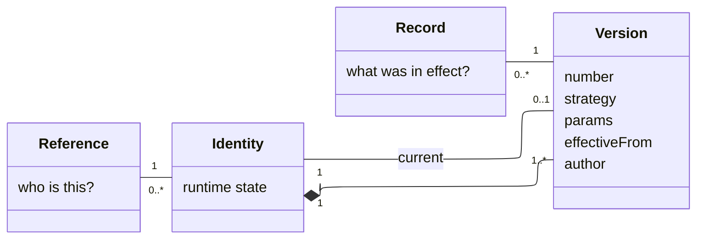

# AquaDash v3 — Conceptual model (notes)

| Author         | Version | Date       | Diagrams                                   |
| -------------- | ------- | ---------- | ------------------------------------------ |
| Thierry Poulin | _v0.1_  | 2026-11-18 | [conceptual-model.md](conceptual-model.md) |
| Thierry Poulin | _v0.2_  | 2026-11-19 | [conceptual-model.md](conceptual-model.md) |
| Thierry Poulin | _v0.3_  | 2026-11-20 | [conceptual-model.md](conceptual-model.md) |

This document explains the diagrams in [conceptual-model.md](conceptual-model.md): what each concept means, why the model has this shape, and what is still open. It follows [vision v1.1](aquadash-v3.0.0-vision.md).

**v0.2 changes:** maintenance sessions are scoped to a Subject instead of a whole system; a new **Hold** primitive covers every kind of pause, and maintenance is built on it; **Isolators** model physical power switches; controllers persist **lockouts** and refuse commands until synced after boot; rules for mutations (rewiring, rebinding) are written down in §4; several loops per system in v3.

**v0.3 changes:**

- Readings are about an **Observable** (a Subject or an Isolator), so isolator sense contacts are ordinary bindings and are never held (D25). Unbound channels don't report (D26).
- Versioned logic is split into a stable **identity** and immutable **versions** (D27, §5). DeviceType follows the same pattern (D31). PortBindings belong to the loop's identity, with a time range (D39).
- Calibration is split into **MeasureCalibration**, **DoseCalibration** and **DeviceCalibration** (D7). Quantity moves to MeasureChannel, derived from its Unit (D6). **Solution** is modeled, with optional concentrations.
- A Dose goes **through an ActuationChannel** and can be **refused**; PolicyLimits count physical amounts, PhysicalLimits count command parameters (D8, D28).
- Command has three subtypes: **ActuateCommand**, **ReadNowCommand** and **DeviceCommand** (D29). Commands carry `issuedAt`, which replaces any need for a controller clock (D35). One actuation per channel at a time, no cancellation (D36).
- A **SystemAction** originator covers what the brain does on its own (D10).
- Holds get a **uid** and a **release acknowledgement** (D32), and record who released them. Emergency-stop Holds are owned by the **Alert**, not the AlertRule, and are released when a person resolves it (D33). An emergency stop never suspends measurement (D30).
- **Maintenance sessions are for physical work, plain Holds for configuration work** (D34). A session's Holds only accumulate until it ends (D18), and only its holder may change what it holds (D19, D23). This replaces v0.2's lists of refused mutations. Overdue sessions are **escalated, not ended** (D15).
- Permissions are given on a **PermissionScope**: the whole Installation, one system, or (post-v3) a group of systems (D16).
- Decisions are recorded only when the loop acts (D38). `Reading.status` stays stored (D37).
- New view **E** instantiates the model for Oasys and lists the drivers the Pi controller needs.
- All ten open questions of the v0.3 draft are answered by the decisions above, except EZO export, which moved to view E. Derived channels and loops that configure devices are described in §6 for later.

---

## 1. Structural principles

1. **Physical and logical are separate (vision 7.5).** The physical side is Controller, Wiring, Device, DeviceType and Channel. The logical side is Observable (Subjects and Isolators), Target, ControlLoop, Decision and Dose. They meet only where a **Channel is bound to an Observable** (or to a loop port) and through **calibrations**. Rewiring hardware changes Wiring; it never changes logic.
2. **The brain knows values, not sensor types.** A channel produces typed values (bool, int or float in a range, bytes). What a value _means_ (EC, pH, temperature, "isolator open") comes from binding it to an Observable, a Unit and a loop port. Supporting a new sensor never needs new code in the brain. "Pump" and "EC sensor" are roles a channel plays, not classes (view E).
3. **Derived associations are not stored.** For example, "this controller serves this reservoir" can be computed through Wiring → Device → Channel → Subject. Storing it as well would create a second source of truth that drifts on every rewire.
4. **Logic is "a strategy plus parameters, versioned."** ReadingFilter, calibrations, AlertRule, Target, ControlLoop and Arbitrator all follow the same pattern: a strategy type chosen from a list, its parameters, a version, and a date it took effect. Changing logic means activating a new version, never editing the old one, so past decisions stay explainable (7.8). Each has a stable identity that the versions belong to (§5).
5. **Every concept has an identity.** The diagrams show `uid` only where the identifier leaves the brain: Controller, Device, Command and Hold. Everything that can raise an alert is an Alertable.

---

## 2. Glossary

### Topology (view A)

| Concept                | Meaning                                                                                                                                                                                                                                                                                                                                                                                                                                          |
| ---------------------- | ------------------------------------------------------------------------------------------------------------------------------------------------------------------------------------------------------------------------------------------------------------------------------------------------------------------------------------------------------------------------------------------------------------------------------------------------ |
| **Observable**         | Anything a reading can be about. It is abstract: a **Subject** or an **Isolator**.                                                                                                                                                                                                                                                                                                                                                               |
| **Subject**            | Anything the brain measures or acts on as part of growing: a site, a system, a reservoir. Readings, targets, alert rules, policy limits and maintenance sessions point at a Subject.                                                                                                                                                                                                                                                             |
| **Site**               | `post-v3`. A physical place (a room, a warehouse) that hosts systems. It lets one ambient sensor serve several systems. In v3, an ambient sensor binds to its HydroponicSystem directly.                                                                                                                                                                                                                                                         |
| **HydroponicSystem**   | The logical unit users think about and that control logic targets. It is made of one or more reservoirs.                                                                                                                                                                                                                                                                                                                                         |
| **Reservoir**          | One body of water. It belongs to **exactly one** system. Its volume drifts (evaporation, leaks), so `nominalVolume` is only an estimate until a level sensor exists.                                                                                                                                                                                                                                                                             |
| **Controller**         | A networked process attached to devices (vision §6). It has an identity and credentials.                                                                                                                                                                                                                                                                                                                                                         |
| **Device**             | A physical piece of hardware with its own identity in the brain, **independent of where it is plugged in**. Its channels and calibrations stay with it when it is rewired.                                                                                                                                                                                                                                                                       |
| **Wiring**             | Device ↔ Controller ↔ locator (bus, address, pin), with a time range. It is what the brain _believes_ is plugged where: the brain is the source of truth for it and pushes it as configuration (vision 7.6, v1.1). A wiring change is pending until the controller confirms it (`confirmedAt`). A Wiring records the DeviceTypeVersion the controller runs for that device.                                                                      |
| **DeviceType**         | A driver, identified by `driverId`. A Device has one DeviceType for its whole life.                                                                                                                                                                                                                                                                                                                                                              |
| **DeviceTypeVersion**  | The descriptor of one version of a driver, as announced by the controllers whose firmware contains it. It lists channels, operations, capabilities (e.g. "on/off only, no intensity") and, if needed, the schema of its device-side calibration. The brain stores it as data. See D31.                                                                                                                                                           |
| **ChannelSpec**        | One channel as the driver documents it: index, direction (measure or actuation), value type, range, raw unit, and a text description ("ch0 = temperature").                                                                                                                                                                                                                                                                                      |
| **Channel**            | One channel of a device, identified by its `index`, with a user-given label. It realizes the ChannelSpec at that index. It is either a **MeasureChannel** or an **ActuationChannel**. A device can have several channels: an EZO-EC can report EC, TDS, salinity and specific gravity, and a pump board can drive 4 pumps.                                                                                                                       |
| **MeasureChannel**     | A channel that produces Readings. It measures at most one Observable, has a report period, and, if numeric, a Unit. Unbound, it doesn't report (D26).                                                                                                                                                                                                                                                                                            |
| **ActuationChannel**   | A channel that receives ActuateCommands. It acts on at most one Subject and, for a pump, delivers one Solution. It has no Quantity: it is driven in command parameters, and a DoseCalibration translates physical amounts into them.                                                                                                                                                                                                             |
| **Isolator**           | A physical switch that cuts power to one or more actuation channels: one pump, several, or a whole pump board. A channel may sit behind several isolators in series. An isolator is **sensed** if a `bool` MeasureChannel is bound to it; otherwise it is a checklist item a person confirms. See §4.3.                                                                                                                                          |
| **Quantity / Unit**    | A shared vocabulary that makes values comparable across systems (see D6).                                                                                                                                                                                                                                                                                                                                                                        |
| **Solution**           | What a pump channel delivers (nutrient A, nutrient B, pH−, …). It may list **Concentrations** (a component and a value in a quantity-per-volume unit, e.g. g/L of N), which lets policies and reports speak in amounts of nutrient rather than mL.                                                                                                                                                                                               |
| **Reading**            | One value from a MeasureChannel. It is **about an Observable**, recorded when the reading is taken, so rebinding a channel later doesn't move old readings. It stores the raw value, the converted and calibrated value (none if rejected), a status (accepted / rejected / corrected, D37), the calibration and filter versions in effect, the ReadNowCommand that requested it if any, and the maintenance session it was taken during if any. |
| **MeasureCalibration** | Brain-side correction of a measure channel's values: raw → value (see D7).                                                                                                                                                                                                                                                                                                                                                                       |
| **DoseCalibration**    | Brain-side translation for an actuation channel: physical amount → command parameters. For our relay pumps, a bench-measured flow rate in mL/s (see D7).                                                                                                                                                                                                                                                                                         |
| **DeviceCalibration**  | Calibration stored on the device, opaque to the brain (see D7).                                                                                                                                                                                                                                                                                                                                                                                  |
| **ReadingFilter**      | The strategy for detecting and handling aberrant data on a channel: thresholds, running statistics, or both (7.7).                                                                                                                                                                                                                                                                                                                               |
| **PhysicalLimit**      | A physical safety limit on an actuation channel: max duration, intensity bounds, duty cap per window. It is modeled in the brain, pushed down, and **enforced by the controller** (see D8).                                                                                                                                                                                                                                                      |
| **ConnectionEvent**    | A transition in a controller's connection (connected or lost, with a reason). Heartbeats themselves aren't stored. These events answer "why didn't the 3 AM dose happen?"                                                                                                                                                                                                                                                                        |
| **Discrepancy**        | A gap between what the brain configured and what the controller reports: device not responding at its locator, driver missing from firmware, a lockout the brain doesn't know about, and so on (7.6). It may point at the Wiring concerned. What it can't point at (an unknown Hold uid, a missing driver) goes in `details`.                                                                                                                    |

### Control and commands (view B)

| Concept                                      | Meaning                                                                                                                                                                                                                                                                                                                                                                                                                                                                                                      |
| -------------------------------------------- | ------------------------------------------------------------------------------------------------------------------------------------------------------------------------------------------------------------------------------------------------------------------------------------------------------------------------------------------------------------------------------------------------------------------------------------------------------------------------------------------------------------ |
| **ControlLoopType**                          | A control strategy offered in a dropdown. It declares named **ports**: inputs (e.g. `ec`) and outputs (e.g. `nutrientA`, `nutrientB`).                                                                                                                                                                                                                                                                                                                                                                       |
| **ControlLoop**                              | One configured instance on a system. `<<versioned>>`: its versions carry parameters; its identity carries the PortBindings and the runtime state (dosing / mixing / measuring / deciding, `lastEvaluatedAt`). It is **paused** when it has a Hold or when a channel bound to one of its ports has one (derived, see §4.1).                                                                                                                                                                                   |
| **PortBinding**                              | Connects a loop port to a channel, for a time range: an input port to a MeasureChannel, an output port to an ActuationChannel. This is how a loop finds "its" pumps and sensors without knowing about hardware (D39).                                                                                                                                                                                                                                                                                        |
| **Arbitrator**                               | Resolves conflicts between a system's loops (e.g. an EC dose making pH drift). v3 uses a trivial arbitrator, which works only because no two v3 loops share an output channel.                                                                                                                                                                                                                                                                                                                               |
| **Target**                                   | The desired value or range of a Quantity on a Subject. `<<versioned>>`. It is a strategy: static in v3, and later it may depend on the growth stage or on other readings.                                                                                                                                                                                                                                                                                                                                    |
| **PolicyLimit**                              | A brain-only cap on what the brain is willing to issue, counted in physical amounts: e.g. at most X mL of pH− per system per day (see D8).                                                                                                                                                                                                                                                                                                                                                                   |
| **Recipe / GrowthStage / RecipeApplication** | `post-v3`. A named bundle of targets and loop configurations per growth stage ("Tomatoes & Strawberries"). Stages change manually or by rule (e.g. elapsed time). A RecipeApplication records when a recipe was applied to a system.                                                                                                                                                                                                                                                                         |
| **Decision**                                 | A loop's decision to act: the loop and target versions in effect, the readings it used, its rationale, and its outcome (`dose`, or `abstain` with an alert). Evaluations that change nothing are not recorded (D38). It is the main object of traceability (7.8).                                                                                                                                                                                                                                            |
| **Dose**                                     | A logical request: "add _V_ mL through pump channel _P_." It records the Solution delivered and the DoseCalibration version used to turn it into one or more ActuateCommands. It is what operators normally issue. It is `accepted` or `refused` (D28).                                                                                                                                                                                                                                                      |
| **Command**                                  | A uniquely identified, bounded directive from the brain to a controller (vision §6), with an `issuedAt` and a deadline. It is one of: **ActuateCommand** (one ActuationChannel), **ReadNowCommand** (one MeasureChannel) or **DeviceCommand** (a whole Device; `mode` is `configure`, replayable, or `procedure`, one-shot) (D29). Operators can issue raw commands from an "advanced" menu, where they may also set the deadline. A command issued by a session holder carries that session's id (see D21). |
| **CommandReport**                            | What the controller reports back for a command: received, refused (with a reason, e.g. `busy`, `expired`, `locked`), completed, or partial (what actually ran, and why it stopped). A report may arrive late, after a reconnect, and change an `unknown` command to a known outcome.                                                                                                                                                                                                                         |
| **Originator**                               | Who issued a Dose or Command, released a Hold, resolved an Alert or ended a session: a **User** (manual), a **Decision** (a loop), or a **SystemAction**.                                                                                                                                                                                                                                                                                                                                                    |
| **SystemAction**                             | Something the brain does on its own, with the `trigger` that caused it: replaying `configure` on reconnect (a ConnectionEvent), raising an Alert (an AlertRule version), escalating an overdue session (the session).                                                                                                                                                                                                                                                                                        |

### People, safety and alerts (view C)

| Concept                      | Meaning                                                                                                                                                                                                                                                                                                                                                                                                    |
| ---------------------------- | ---------------------------------------------------------------------------------------------------------------------------------------------------------------------------------------------------------------------------------------------------------------------------------------------------------------------------------------------------------------------------------------------------------- |
| **User / Group / Principal** | Groups carry baseline permissions shared by their members.                                                                                                                                                                                                                                                                                                                                                 |
| **Membership**               | Gives a role to a principal on a PermissionScope (D16).                                                                                                                                                                                                                                                                                                                                                    |
| **PermissionScope**          | What a role applies to: the **Installation**, one **HydroponicSystem**, or, post-v3, a **SystemGroup**.                                                                                                                                                                                                                                                                                                    |
| **Installation**             | This AquaDash deployment as a whole. There is exactly one. A role on it (e.g. admin) applies everywhere.                                                                                                                                                                                                                                                                                                   |
| **SystemGroup**              | `post-v3`. A named set of systems (the five Bourgeon units), so a role can be given on all of them at once.                                                                                                                                                                                                                                                                                                |
| **Hold**                     | Stops one Holdable (a ControlLoop, a MeasureChannel or an ActuationChannel) on behalf of an owner (a User, a MaintenanceSession or an Alert), with a reason. Holds stack; each owner releases only its own, and admins may release any. It has a uid, because controllers key their lockouts by it. See §4.1.                                                                                              |
| **MaintenanceSession**       | Takes a Subject out of service while one person (the holder) works on it physically: changing water, refilling a tank, fixing tubing, replacing or moving hardware. It keeps Holds on every channel in its scope, plus any the holder added, and only accumulates them until it ends. It has a mandatory `plannedEnd`; past it, the session is overdue and escalated. See §4.2.                            |
| **AlertRule**                | A condition on readings, evaluated continuously and attached to a Subject. `<<versioned>>`. Its `action` is a warning or an emergency stop. Its `releaseMode` says whether an emergency stop is released by a person (default) or automatically once the condition clears (D33). It belongs to the brain, not to the sensor.                                                                               |
| **Alert**                    | One occurrence of something worth telling people: raised by a rule version, a decision that abstains, a lost connection, a discrepancy, an overdue session, and so on. It concerns any Alertable (Subject, Isolator, Controller, Device, Channel, Command, ControlLoop, MaintenanceSession). An Alert raised by an emergency-stop rule **owns** the Holds of that stop; resolving the Alert releases them. |
| **Subscription**             | A user follows a system, which covers all alerts under it, and chooses delivery (email, in-app, both or neither). Finer-grained subscriptions come later; since Channel, Device and Controller are already Alertable, that needs no model change.                                                                                                                                                          |

### Controller side (view D)

| Concept                           | Meaning                                                                                                                                                                                                                                    |
| --------------------------------- | ------------------------------------------------------------------------------------------------------------------------------------------------------------------------------------------------------------------------------------------ |
| **BrainLink**                     | The connection to the brain, whatever the transport (vision §8). It keeps the clock offset learned at connection, and the controller's boot time in brain time. Until the first configuration sync after boot, it lets no command through. |
| **ConfigStore**                   | Volatile. It holds wiring, limits, report periods and reporting suspensions, all received again on every connection.                                                                                                                       |
| **LockoutStore**                  | Persistent. The controller's copy of every Hold on one of its actuation channels. Every controller must implement it (§4.4).                                                                                                               |
| **DriverCatalog / Driver**        | The drivers compiled into the firmware. Their descriptors are announced to the brain and become DeviceTypeVersions there.                                                                                                                  |
| **DriverInstance / LocalChannel** | A driver instance created for one device at one locator, as the wiring requires, with its health status. Commands reach it by device uid. A LocalChannel runs one actuation at a time.                                                     |
| **Reporter**                      | Sends periodic readings for a measure channel.                                                                                                                                                                                             |
| **CommandInbox**                  | Keeps the commands it has seen, with their reports, until their deadline passes (7.4). It answers a resent id with the original report, and refuses commands past their deadline or issued before the controller's boot (D35).             |
| **SafetyGovernor**                | Enforces PhysicalLimits, including the duty window, and the lockouts. It refuses; it never modifies a command (see D5).                                                                                                                    |
| **Executor**                      | Runs actuations with a stop that **does not depend on the code that started them** (see §7). Aborts a running actuation when a lockout is applied to its channel.                                                                          |
| **OutboundQueue**                 | Buffers readings and reports while the brain is unreachable.                                                                                                                                                                               |

---

## 3. Design decisions

| #   | Decision                                                                                                                                                                                                                                                                                                                                                                                                                                                                                                                                                                                                                                                                                                                                       | Rationale                                                                                                                                                                                                                                                                                                                                                                                                                                                                                                       |
| --- | ---------------------------------------------------------------------------------------------------------------------------------------------------------------------------------------------------------------------------------------------------------------------------------------------------------------------------------------------------------------------------------------------------------------------------------------------------------------------------------------------------------------------------------------------------------------------------------------------------------------------------------------------------------------------------------------------------------------------------------------------- | --------------------------------------------------------------------------------------------------------------------------------------------------------------------------------------------------------------------------------------------------------------------------------------------------------------------------------------------------------------------------------------------------------------------------------------------------------------------------------------------------------------- |
| D1  | **Channels, not sensor types.** The brain sees typed value streams. Meaning comes from binding.                                                                                                                                                                                                                                                                                                                                                                                                                                                                                                                                                                                                                                                | New hardware means only a new driver. Two EC channels on the same reservoir are allowed; the UI may warn about duplicate dosing but doesn't forbid it.                                                                                                                                                                                                                                                                                                                                                          |
| D2  | **Readings belong to what they observe, not to sensors.**                                                                                                                                                                                                                                                                                                                                                                                                                                                                                                                                                                                                                                                                                      | A reading describes the water, the environment, or an isolator's state. The sensor is just how it was obtained.                                                                                                                                                                                                                                                                                                                                                                                                 |
| D3  | **Device identity is separate from Wiring.**                                                                                                                                                                                                                                                                                                                                                                                                                                                                                                                                                                                                                                                                                                   | A rewire, even onto another controller, keeps the device's calibration and channel bindings. Moving a device's channels to a different _Subject_ changes their meaning, so it follows D23: the loops that depend on them must be paused first.                                                                                                                                                                                                                                                                  |
| D4  | **The brain pushes the wiring; controllers announce driver catalogs.** This replaces vision v1.0 §7.6 (corrected in v1.1).                                                                                                                                                                                                                                                                                                                                                                                                                                                                                                                                                                                                                     | The controller can't know which physical device is where. Microcontroller firmware becomes "a library of drivers plus configuration."                                                                                                                                                                                                                                                                                                                                                                           |
| D5  | **Controllers refuse or report partial execution; they never modify commands.**                                                                                                                                                                                                                                                                                                                                                                                                                                                                                                                                                                                                                                                                | If the controller clamped a command, the brain's dose accounting would stop being deterministic, and the controller would be making decisions. A refusal with a reason gives the brain everything it needs to replan.                                                                                                                                                                                                                                                                                           |
| D6  | **Units are a shared Quantity vocabulary with affine conversions.** Each Quantity has a canonical unit and a list of Units, each with `factor` and `offset` to the canonical one (an offset is needed for °F). A numeric MeasureChannel declares the Unit its values come in, by default the driver's `rawUnit`; its Quantity is the one that Unit belongs to. `bool` and `bytes` channels have no Unit. The brain stores values in canonical units and displays them in the user's choice. There is an **"Other"** escape: a custom Quantity and unit, which is only comparable to itself.                                                                                                                                                    | This makes EC from system 1 comparable to EC from system 2, whatever each driver reports (mS/cm, µS/cm, mS/m). Deriving the Quantity from the Unit means the two can't disagree. Unit conversion is exact by definition, which is different from calibration (D7), which corrects device error.                                                                                                                                                                                                                 |
| D7  | **There are three kinds of calibration.** **MeasureCalibration** (raw → value) and **DoseCalibration** (physical amount → command parameters) are brain-side. The brain uses them in its own arithmetic, so they support a small fixed set of _models_ (linear, polynomial, piecewise-linear table): code written once per model, never per device. **DeviceCalibration** is device-side and opaque to the brain. It is described by the driver's schema, so the UI renders a generic form, and it is pushed with a DeviceCommand. It comes in two forms: `replayable` (data, resent on every connection) and `procedure` (a one-shot action performed by a human in the right physical context, never replayed, but recorded as a log entry). | The two brain-side kinds run in opposite directions and belong to different channel kinds, so they are separate concepts. No code per device type in the brain. Atlas EZO calibration is a procedure: `Cal,mid,7.00` means "the probe is in pH 7 buffer _right now_." Replaying it with the probe in the reservoir would corrupt the calibration. Today's code ([AtlasI2C.py](../../Sensors/services/AtlasI2C.py)) only knows that `CAL` needs a longer timeout, so calibration was done by hand on the device. |
| D8  | **Limits have two layers, in two languages.** A **PhysicalLimit** protects hardware. It counts seconds, intensity and duty, is checked on Commands, and the controller is the final barrier. A **PolicyLimit** is a brain-only cap on what the brain issues. It counts physical amounts (mL of a Solution, or of a component through its Concentration), is checked on Doses before conversion, and counts the volume actually delivered according to CommandReports, plus the full volume of any Command whose report hasn't come back.                                                                                                                                                                                                       | The controller's limits are about physical safety, nothing less and nothing more. Policies are the brain's business, and must be in physical units: activation times change every time a pump is recalibrated. Counting unreported Commands in full errs on the safe side.                                                                                                                                                                                                                                      |
| D9  | **Dose and Command are separate.** A Dose goes through one ActuationChannel.                                                                                                                                                                                                                                                                                                                                                                                                                                                                                                                                                                                                                                                                   | A Dose is logical ("5 mL through pump A"), a Command is physical ("run 4.2 s"), and the channel's DoseCalibration translates between them (7.5). The brain may split one dose into several commands. Manual activation is normally a Dose, with raw Commands behind an "advanced" menu. Loops name their output channels through PortBindings, so a Dose never needs to choose between pumps.                                                                                                                   |
| D10 | **One Originator covers User, Decision and SystemAction.**                                                                                                                                                                                                                                                                                                                                                                                                                                                                                                                                                                                                                                                                                     | Manual, automatic and brain-initiated actions follow the same path: bounded, confirmed, traced (7.9). Without SystemAction, a configuration replay or an alert-triggered stop would have nobody to answer "who did this?"                                                                                                                                                                                                                                                                                       |
| D11 | **Read-now is a Command.** Periodic reporting stays the baseline. The Reading it produces records it.                                                                                                                                                                                                                                                                                                                                                                                                                                                                                                                                                                                                                                          | A loop that has waited 15 min for mixing should decide on a fresh reading, not one from 2 min ago. Users may also request one. A loop resuming from a pause also starts with one.                                                                                                                                                                                                                                                                                                                               |
| D12 | **Store connection transitions, not heartbeats.**                                                                                                                                                                                                                                                                                                                                                                                                                                                                                                                                                                                                                                                                                              | They cost almost nothing and are what traceability needs. Current state is derived from the latest event.                                                                                                                                                                                                                                                                                                                                                                                                       |
| D13 | **Loops have ports and an Arbitrator.** In v3: a dropdown with two loop types (EC → A/B; EC + pH → A/B/pH±), several loops per system (at least one per reservoir on Oasys), no two loops sharing an output channel, and a trivial arbitrator.                                                                                                                                                                                                                                                                                                                                                                                                                                                                                                 | This leaves room for real arbitration later without changing the model. The trivial arbitrator is only correct because v3 loops don't share outputs.                                                                                                                                                                                                                                                                                                                                                            |
| D14 | **Calibrations are versioned, and readings and doses record the versions in effect.**                                                                                                                                                                                                                                                                                                                                                                                                                                                                                                                                                                                                                                                          | Old readings can be recomputed under a new calibration if someone wants that, or kept as they are. Raw values are always kept.                                                                                                                                                                                                                                                                                                                                                                                  |
| D15 | **Maintenance sessions have a mandatory planned end, and are escalated, never ended, when it passes.** The brain warns the holder before `plannedEnd` and lets them extend it. Past it, the session is **overdue**: the brain alerts the holder, then the managers of the systems in scope, then the Installation admins, and repeats with rising severity until someone ends or extends the session. Its Holds stay. Controllers never release a lockout on their own clock either.                                                                                                                                                                                                                                                           | A lockout that disappears too early can hurt someone; one left hanging only costs production. That holds for the brain's clock as much as for the controller's, so nothing ends a session on a timer. Escalation makes sure an abandoned session is noticed.                                                                                                                                                                                                                                                    |
| D16 | **Permissions are given as a role on a PermissionScope**: the Installation, one HydroponicSystem, or (post-v3) a SystemGroup. Groups of principals carry shared baselines. Starting a session requires the permission on every system its scope touches.                                                                                                                                                                                                                                                                                                                                                                                                                                                                                       | Botanists can own their systems; admins are simply a role on the Installation, and a "manager" a role on a system. Groups avoid assigning everyone one at a time. SystemGroups will let the five Bourgeons be granted at once.                                                                                                                                                                                                                                                                                  |
| D17 | **Hold is the single pause primitive.** Pausing a loop, suspending a measure channel, inhibiting an actuation channel, an emergency stop and maintenance are all Holds with different owners.                                                                                                                                                                                                                                                                                                                                                                                                                                                                                                                                                  | One mechanism, one enforcement path down to the controller, and "why is this stopped?" always has an answer. `ControlLoop.paused` becomes derived.                                                                                                                                                                                                                                                                                                                                                              |
| D18 | **A MaintenanceSession is scoped to a Subject, and its Holds only accumulate.** The brain adds Holds whenever resolve(scope) ∪ extras grows, and releases none of them before the session ends, when all are released together.                                                                                                                                                                                                                                                                                                                                                                                                                                                                                                                | A reservoir can be serviced without stopping the whole system. Because Holds are never removed mid-session, coverage can't shrink, whatever the holder rebinds, moves or removes, so no mutation has to be refused on that account. The Subject is kept because it is the rule the session keeps applying (§4.2).                                                                                                                                                                                               |
| D19 | **While a session holds something, only its holder may change it; while two sessions hold it, nobody may.** This follows from the Hold's owner, not from a stored flag, and Hold has no subclasses.                                                                                                                                                                                                                                                                                                                                                                                                                                                                                                                                            | A plain Hold exists to make a thing changeable; a session must protect the person at the hardware from changes made by others. Two people working on the same hardware must coordinate: one ends their session, or an admin ends one. The UI shows who else holds it. A "do not touch" tag outside maintenance is modeled as a one-channel session.                                                                                                                                                             |
| D20 | **Controllers persist lockouts and refuse all commands after boot until synced.** Every controller implements the lockout contract (§4.4).                                                                                                                                                                                                                                                                                                                                                                                                                                                                                                                                                                                                     | A reboot during maintenance must not erase a lockout. The boot gate also stops a controller from acting on anything before it knows its current wiring, limits, lockouts and the time.                                                                                                                                                                                                                                                                                                                          |
| D21 | **Holder commands carry the session id.** On a locked channel, the controller accepts an ActuateCommand only if it names a session and **every** unreleased Hold on that channel is owned by that session.                                                                                                                                                                                                                                                                                                                                                                                                                                                                                                                                     | This is a **guard against bugs and accidents, not security.** Anyone able to forge a holder's command could also forge a release. What it does stop: automation leaking through (Decisions never carry a session id), stale or replayed commands, dosing into a reservoir someone else has under their own session, and a holder pumping through an emergency stop or someone's manual pause.                                                                                                                   |
| D22 | **Isolators are the bottom safety layer.** A session locks first, then the holder isolates: it becomes "safe to work" only once every Isolator on a locked channel is confirmed (sensed, or ticked on a checklist). Ending a session restores Isolators before releasing Holds. Acid and base pumps each get their own switch, and training requires flipping it even inside a session.                                                                                                                                                                                                                                                                                                                                                        | Software layers (brain refuses, controller refuses) cover bugs and outages, but not an attacker who looks like the brain to the controller, nor a relay stuck closed. Only cutting power rules out being sprayed. Locking first means the module is already protected when the person walks up to it.                                                                                                                                                                                                           |
| D23 | **A channel's meaning can change only while it is held** (directly or through all its dependents), and, if a session holds it, only by that session's holder (D19). Meaning-changing mutations: rebinding it to another Observable, changing its Solution or calibration, rewiring its device.                                                                                                                                                                                                                                                                                                                                                                                                                                                 | A running loop whose output is re-pointed would dose something else. Requiring a Hold makes the change explicit, and the Hold covers the time during which what the brain believes and what is plugged in disagree (§4.5).                                                                                                                                                                                                                                                                                      |
| D24 | **Periodic reporting stops in a maintenance scope.** Read-now and calibration (DeviceCommands) remain allowed under the session; their readings are tagged with the session.                                                                                                                                                                                                                                                                                                                                                                                                                                                                                                                                                                   | Periodic readings exist for monitoring and loop inputs, and both are suspended during maintenance anyway. Calibration is often the whole reason for the maintenance.                                                                                                                                                                                                                                                                                                                                            |
| D25 | **Readings are about Observables: Subjects or Isolators.** An isolator's sense contact is a `bool` MeasureChannel bound to the Isolator.                                                                                                                                                                                                                                                                                                                                                                                                                                                                                                                                                                                                       | Its state isn't about any reservoir or system, and binding it to one would put it in that Subject's maintenance scope, suspending it exactly when the session needs it (§4.2). Binding it to the Isolator keeps it out of every scope, with no special channel type: the same GPIO input could be a float switch measuring a reservoir.                                                                                                                                                                         |
| D26 | **Unbound channels don't report, and produce no stored Readings.** A live value may be shown while commissioning.                                                                                                                                                                                                                                                                                                                                                                                                                                                                                                                                                                                                                              | A Reading must be about something (D2). Channels exist unbound between device registration and binding, and after an unbind.                                                                                                                                                                                                                                                                                                                                                                                    |
| D27 | **Versioned logic has a stable identity and immutable versions.** What asks "who is this?" points to the identity; what records "what was in effect?" points to a version. See §5.                                                                                                                                                                                                                                                                                                                                                                                                                                                                                                                                                             | Edit the high-EC rule from "EC > 3" to "EC > 2.5": last week's Alert must still say it was raised by "> 3", while Subscriptions, Targets and loops keep pointing at "the high-EC rule". One object can't do both: overwriting breaks history, and replacing it orphans everything that pointed at it.                                                                                                                                                                                                           |
| D28 | **A Dose can be refused.** It is refused by a PolicyLimit, or because a sensed Isolator on its channel reads isolated (§4.3). A refused Dose is kept, and has no Commands. An accepted Dose with `volume > 0` has at least one.                                                                                                                                                                                                                                                                                                                                                                                                                                                                                                                | "The loop wanted to dose, and policy stopped it" is exactly what traceability needs to show.                                                                                                                                                                                                                                                                                                                                                                                                                    |
| D29 | **Command has three subtypes.** An **ActuateCommand** targets one ActuationChannel, a **ReadNowCommand** one MeasureChannel, a **DeviceCommand** (`configure` or `procedure`) one Device. The Device of a channel command is derived from its channel.                                                                                                                                                                                                                                                                                                                                                                                                                                                                                         | A driver instance is what interprets commands, and device-level operations (calibration, configuration) have no channel. Subtypes make wrong targets impossible (an actuate on a sensor), avoid storing the Device twice (principle 3), and let other associations be precise: a Dose is realized by ActuateCommands, a Reading requested by a ReadNowCommand.                                                                                                                                                  |
| D30 | **What a Hold owner holds depends on its kind.** A MaintenanceSession holds every channel bound to its scope plus its extras. An Alert raised by an emergency-stop rule holds the ActuationChannels and ControlLoops of the rule's Subject, never MeasureChannels.                                                                                                                                                                                                                                                                                                                                                                                                                                                                             | Maintenance stops monitoring because nothing in scope is in service. An emergency is when monitoring matters most.                                                                                                                                                                                                                                                                                                                                                                                              |
| D31 | **DeviceType is a driver identity; DeviceTypeVersion is one version of its descriptor.** A device may be wired onto a controller only if that controller's version is **compatible** with the device's channels: the same ChannelSpecs by index, direction and value type. Wiring records the version it runs under.                                                                                                                                                                                                                                                                                                                                                                                                                           | Controllers can run different firmware. A rewire onto an older or newer driver must not silently change what a channel index means. Recording the version on the Wiring answers "which driver produced this reading?" without storing it on every Reading.                                                                                                                                                                                                                                                      |
| D32 | **Holds have a uid, and releasing one is acknowledged.** A controller acknowledges a release only once the lockout is removed from durable storage; the brain records `releaseConfirmedAt` and resends unacknowledged releases on reconnect.                                                                                                                                                                                                                                                                                                                                                                                                                                                                                                   | Without this, a release sent to an offline controller would come back on reconnect as a lockout the brain doesn't know about, and need an admin (§4.4.7). The uid is what both sides key the lockout by.                                                                                                                                                                                                                                                                                                        |
| D33 | **An emergency stop's Holds are owned by the Alert that triggered it, and by default a person releases them by resolving the Alert.** A rule may instead release automatically when its condition clears (`releaseMode = auto`), and then must use hysteresis: a release threshold distinct from the trigger threshold (stop below 20 %, release above 25 %), or a minimum hold time.                                                                                                                                                                                                                                                                                                                                                          | Readings returning to normal don't prove the cause was fixed (EC that didn't rise after dosing may be an empty tank or broken tubing), so the safe default is a person. Owning Holds by the Alert keeps two firings of the same rule separate, and survives the rule being edited. Without hysteresis, a level hovering at the threshold would start and stop the pumps on every reading. Releasing is safe either way, because Holds stack: other owners keep theirs.                                          |
| D34 | **A maintenance session is for physical work; a plain Hold is for configuration work.** If someone will touch the hardware (change water, refill, fix tubing, replace or move a device), they start a session. If they only edit the brain's configuration (fix a wrong pin, rebind a sensor bound to the wrong reservoir), they hold what depends on it, edit, and release.                                                                                                                                                                                                                                                                                                                                                                   | A session exists to protect a person and to keep their work out of the data: isolators, muted alerts, tagged readings, a visible status. None of that applies to a configuration fix, for which a Hold is enough (D23).                                                                                                                                                                                                                                                                                         |
| D35 | **Commands carry `issuedAt` in brain time, and a controller refuses any command issued before its own boot.** Controllers take brain time at every sync (the boot gate guarantees one before any command) and keep it with a monotonic clock. They need no RTC or NTP; only the brain does.                                                                                                                                                                                                                                                                                                                                                                                                                                                    | Deadlines need a shared clock, which the sync provides; drift between syncs is seconds per day. Refusing commands issued before boot means a controller never needs to remember, across a reboot, which commands it has already run.                                                                                                                                                                                                                                                                            |
| D36 | **No supersession: one actuation per channel at a time, and short deadlines.** A second ActuateCommand on a busy channel is refused (`busy`); queueing is the brain's job. A command whose outcome is `unknown` is treated, for timing, as if it completed: the loop waits the mixing time, reads, and decides on what it sees. Resending the same command id returns the original report instead of running again.                                                                                                                                                                                                                                                                                                                            | The brain never needs to cancel anything: deadlines are short, and the empirical reading after mixing is what matters. For PolicyLimits, unknown commands already count in full (D8). Keeping each command's report until its deadline costs a few dozen small entries.                                                                                                                                                                                                                                         |
| D37 | **`Reading.status` is stored even though it is derivable.**                                                                                                                                                                                                                                                                                                                                                                                                                                                                                                                                                                                                                                                                                    | `value` always differs from `rawValue` (unit conversion, calibration), so "corrected" can only be recomputed by re-running the pipeline at the recorded versions. A Reading never changes, so the stored status can't drift (principle 3 is about mutable sources).                                                                                                                                                                                                                                             |
| D38 | **A Decision is recorded only when the loop acts:** `dose`, or `abstain` with an alert. The loop's `lastEvaluatedAt` (runtime state, overwritten) shows it is alive.                                                                                                                                                                                                                                                                                                                                                                                                                                                                                                                                                                           | "Nothing to do" is the absence of a decision, and recording it would be high-volume noise. "Why didn't it dose at 3 AM?" is answered by Readings (in range), Holds (paused), ConnectionEvents (offline) and `lastEvaluatedAt` (stalled).                                                                                                                                                                                                                                                                        |
| D39 | **PortBindings belong to the loop's identity, with a time range like Wiring.** Changing one doesn't create a loop version; it requires the loop to be held (D23).                                                                                                                                                                                                                                                                                                                                                                                                                                                                                                                                                                              | A Decision already records the channels it actually used, through its Readings and Doses. The time range keeps the audit trail without multiplying versions.                                                                                                                                                                                                                                                                                                                                                    |

---

## 4. Holds, maintenance and mutations

### 4.1 Holds

A **Hold** stops one Holdable on behalf of one owner. A Holdable is active if and only if it has no unreleased Hold. Holds stack, so a pump stopped by an emergency stop and by a maintenance session restarts only once both are released.

| Held thing       | Effect                                                                                                                                                                                                        |
| ---------------- | ------------------------------------------------------------------------------------------------------------------------------------------------------------------------------------------------------------- |
| ControlLoop      | Makes no decisions.                                                                                                                                                                                           |
| MeasureChannel   | Periodic reporting is suspended (pushed to the controller as configuration; not persisted). Read-now still works.                                                                                             |
| ActuationChannel | ActuateCommands are refused, except as allowed by D21. Pushed to the controller and persisted as a lockout (§4.4). `Hold.confirmedAt` and `Hold.releaseConfirmedAt` record the controller's acknowledgements. |

What each owner holds (D30):

| Owner                               | Holds                                                                                                                                                                                               |
| ----------------------------------- | --------------------------------------------------------------------------------------------------------------------------------------------------------------------------------------------------- |
| User                                | Whatever the user picked.                                                                                                                                                                           |
| MaintenanceSession                  | resolve(scope) ∪ extras: every MeasureChannel and ActuationChannel bound to the scope Subject or one of its descendants, plus the channels added by hand. Accumulates until the session ends (D18). |
| Alert (from an emergency-stop rule) | The ActuationChannels bound to the rule's Subject or its descendants, and the ControlLoops of the systems concerned. Never MeasureChannels.                                                         |

Channels bound to an Isolator are bound to no Subject, so no resolution ever reaches them (D25).

- A loop is paused when it has a Hold **or** any channel bound to one of its ports has one. This is derived (principle 3). When it resumes, its first decision uses a fresh read-now (D11).
- A Hold owned by a User makes its target changeable by anyone allowed to. A Hold owned by a session makes it changeable only by that session's holder (D19).
- **Releasing.** An owner releases its own Holds: a user by hand, a session when it ends, an Alert when it is resolved (D33). An admin may release any Hold, after confirming, and the owner is notified. `released by` records who did it.

### 4.2 Maintenance sessions

A session means **someone is physically working on this part of the installation** (D34). It has an **intent** (a scope Subject, plus channels the holder added by hand) and a **materialization** (the Holds that exist right now). The brain resolves the scope into channels when the session starts. The resolved list is **shown to the person starting the session**, who can add channels to it. They need to, because a pump plumbed into Reservoir 2 might be bound to the system, or not bound at all.

**Invariant (D18):** the session's Holds only accumulate. At every moment they include resolve(scope) ∪ extras, and none is released before the session ends. The brain re-checks resolve(scope) on every mutation that touches bindings. The Subject is kept for as long as the session lasts because several things need it:

| During the session                                                                   | Needs the Subject?                                                        |
| ------------------------------------------------------------------------------------ | ------------------------------------------------------------------------- |
| Keeping a channel held after it is rebound elsewhere or its device removed           | No: its Hold simply stays until the session ends.                         |
| Binding a new channel into the scope (installing hardware), or rebinding one into it | **Yes**: it must get a Hold right away.                                   |
| Muting AlertRules on Subjects in scope, including rules created mid-session          | **Yes**                                                                   |
| Tagging readings (D24)                                                               | **Yes** (readings are about Subjects, D2)                                 |
| Status and notifications ("Reservoir 2 under maintenance, ends in 10 min")           | **Yes**: a reservoir with no channels would otherwise show as in service. |
| Auditing what the holder meant versus what was locked                                | **Yes**                                                                   |
| Pausing loops, holder commands, ending the session                                   | No                                                                        |

**Lifecycle:**

1. `requested`: the brain creates the Holds and pushes them.
2. `locked`: every affected controller has confirmed its actuation Holds. If a controller is offline, the UI must not show the module as safe; it says "controller X hasn't confirmed: physically isolate it."
3. `isolated`: every Isolator covering a locked channel reads isolated, or the holder has ticked it on the checklist (recorded). The UI shows "safe to work" only from here.
4. `releasing`: the holder restores the Isolators (checked if sensed, warned about if not), then the Holds are released.
5. `ended`.

**Stepping back.** When a channel is bound into the scope, or a held device is moved to another controller, a `locked` or `isolated` session goes back to `requested` until the new Holds are confirmed, then to `locked` until any new Isolator is confirmed. The UI stops showing "safe to work" in the meantime.

**Planned end and overdue sessions (D15):** the holder is warned before `plannedEnd` and can extend it. Past it, the session is overdue and escalated: holder, then managers of the systems in scope, then Installation admins, with rising severity, until someone ends or extends it. Its Holds stay in place. An admin can end someone else's session, overdue or not, but must confirm, and the holder is notified.

**Overlap:** sessions may overlap (Oasys as a whole and Reservoir 2). Holds stack, so a channel is released only when every session holding it has ended. While two sessions hold a channel, neither holder can actuate it (D21) or change it (D19); the UI shows who else holds it.

### 4.3 Isolators

An Isolator de-energizes one or more actuation channels; a channel may sit behind several. Its state is known only if a `bool` MeasureChannel is bound to it (D25).

- **In maintenance:** see the `isolated` and `releasing` steps above.
- **Outside maintenance:** if a sensed Isolator reads isolated, the brain refuses Doses and Commands to its channels (D28) and raises an alert. Otherwise a command would report `completed` with nothing pumped, and dose accounting would drift without anyone noticing.
- **In v3 this is enforced by the brain**, because the sense contact may be wired to a different controller than the pump.

### 4.4 Controller lockout contract

Every controller implementation must provide a LockoutStore and respect this contract:

1. **Durable before acknowledged.** Adding a lockout is acknowledged only after it is written to durable storage (fsync on the Pi, NVS commit on the ESP32); removing one, only after the removal is. The brain sets `Hold.confirmedAt` and `Hold.releaseConfirmedAt` on those acknowledgements, and resends unacknowledged releases on reconnect (D32).
2. **Applied at boot, before connecting.**
3. **Boot gate.** After boot, refuse every command until the configuration has synced (D20), and from then on refuse any command issued before the boot (D35).
4. **Applying aborts.** Applying a lockout aborts any actuation running on that channel and drops commands queued for it.
5. **Keyed by Hold.** Entries are stored per Hold uid and owner. A channel locked by several Holds stays locked until all are released.
6. **Explicit release only.** An entry is removed only by an explicit release for that Hold. Never on a timer.
7. **Announced on connect.** The controller lists the lockouts it holds. An entry the brain doesn't know about (e.g. after losing its database) raises a Discrepancy. Only an admin action releases it, never automatic reconciliation.
8. **Session-tagged commands** are accepted on a locked channel only as described in D21.

Lockouts are a distinct message type, separate from `configure`, so no ordinary configuration push can drop one.

### 4.5 Mutation rules

**Most ordering is referential integrity.** You can't create something before what it points to exists, and you can't delete something while something else points to it. Setting up goes forward, tearing down goes backward:

```
DeviceType(Version) announced → Device registered (Channels created from its ChannelSpecs)
→ Wiring → Channel bound to Observable / Unit / Solution → calibration
→ PortBinding → loop enabled
```

When a step is refused, the brain shows what blocks it ("this channel is used by loop L3"). A rejected request is refused, never queued: the brain checks again at the moment it handles each request.

**Changing a channel's meaning (D23):** rebinding it to another Observable, changing its Solution or calibration, or rewiring its device requires that it be held, directly or through all its dependents. If a session holds it, only that session's holder may make the change (D19).

**Topology changes have two halves:** the physical change (someone moves a wire) and the logical one (someone tells the brain, by changing the Wiring). They can't happen at the same instant, and they don't need to: in between, the brain's picture is wrong, but everything involved is held, so nothing acts on it. **The Hold covers the window in which physical and logical wiring disagree**, whichever half comes first.

- **Physical change** (moving a pump to another pin, an EZO to another Pi, replacing a broken pump): someone touches the hardware, so it is a session (D34). The holder does both halves, in either order. The controller then confirms the new Wiring, which checks the person's claim: if an I2C sensor doesn't answer at its new address, that is a Discrepancy. A relay pump can't be checked that way, so the holder test-runs it under the session (D21) before ending.
- **Logical-only fix** (the brain was told the wrong pin; a sensor was bound to the wrong reservoir): hold what depends on it, edit, release. No session.

**During a maintenance session:**

- **Held at once:** wiring a new device, or binding a new channel into the scope. Its Hold is pending until the controller confirms it, and the session steps back (§4.2).
- **Moving a held device to another controller:** the brain pushes its Hold to the new controller first. The new Wiring stays pending until that controller confirms the Hold, and the session steps back meanwhile. The old controller keeps its lockout until the session ends, which is harmless.
- **Rebinding or unbinding a held channel:** allowed to the holder. Its Hold stays until the session ends (D18), so coverage never shrinks.
- **Deleting a held device** waits until the session ends, because its Holds still point at it. Replacing a pump therefore works: the new pump is held as soon as it is bound, the old one stays held until the end, even if it is physically gone, and is deleted afterwards.

**Wiring changes** are pending until the controller confirms them. Commands to a channel with pending wiring are refused. A wiring is refused if the controller's DeviceTypeVersion isn't compatible with the device's channels (D31).

---

## 5. Identity and versions

Every concept whose logic is "a strategy plus parameters" (principle 4) is split into a stable **identity** and a list of immutable **versions**. The diagrams show it once per class, as `<<versioned>>`.



- A version is never edited. Changing logic means creating a new version and making it current; `effectiveFrom` says when.
- An identity with no current version is disabled.
- Runtime state (a loop's dosing / mixing / measuring state, `lastEvaluatedAt`) and bindings with their own time range (PortBindings) belong to the identity: they aren't versioned configuration.

| Concept                           | Identity                | Pointed to by the identity              | Pointed to by a version (in effect)         |
| --------------------------------- | ----------------------- | --------------------------------------- | ------------------------------------------- |
| ControlLoop                       | the loop                | Holds, Arbitrator, Alerts, PortBindings | Decisions                                   |
| Target                            | the target              | ControlLoops (pursues), GrowthStages    | Decisions                                   |
| AlertRule                         | the rule                | Subject                                 | Alerts                                      |
| Arbitrator                        | the system's arbitrator | HydroponicSystem                        | `post-v3`: decisions under real arbitration |
| ReadingFilter, MeasureCalibration | the MeasureChannel      | —                                       | Readings                                    |
| DoseCalibration                   | the ActuationChannel    | —                                       | Doses                                       |
| DeviceCalibration                 | the Device              | —                                       | Readings                                    |
| DeviceType                        | `driverId`              | Devices                                 | Wirings, Controllers (firmware supports)    |

Calibrations and filters were already modeled this way: their rows are versions, and the channel or device is the identity.

---

## 6. Modeled but not in v3

- **Site**: needed once one sensor serves several systems (a warehouse thermometer). In v3, ambient sensors bind to their HydroponicSystem.
- **SystemGroup**: granting a role on several systems at once (the Bourgeons). In v3, roles are given per system or on the Installation.
- **Recipe, GrowthStage, RecipeApplication**: v3 has static Targets and hand-picked loop parameters.
- **Dynamic Targets**: a target as a function of growth stage or of other readings ("if it's cold, …").
- **Real arbitration between loops that share outputs.**
- **Water level management**: a level sensor plus a refill valve. These are a new MeasureChannel and ActuationChannel bound to a Reservoir. An ultrasonic sensor such as the SEN0311 reports a distance, so it also needs a derived channel (next item) to give a level or volume.
- **Derived channels.** A **DerivedChannel** is a measure channel computed by the brain rather than read from a device. It has no Device or Wiring. It takes one or more input channels by name, like loop ports, and a `<<versioned>>` **Derivation** (strategy + parameters) chosen from a fixed set: the calibration models (linear, polynomial, table) for one input, and a few multi-input formulas written once each. It produces Readings like any measure channel, about an Observable and in a Unit, and each Reading records the input Readings it came from. Loops and alert rules bind to it without knowing it is computed. Structurally, Readings, bindings and PortBindings would point at an abstract _MeasureSource_ with two subtypes: MeasureChannel (on a device) and DerivedChannel (in the brain). Examples: distance → level → volume (using the reservoir's geometry), EC compensated to 25 °C from EC and water temperature, VPD from air temperature and humidity.

  A Derivation differs from a calibration by **what its parameters describe**:

  | Transform          | Its parameters describe                 | Changes the Quantity? | Belongs to                                             |
  | ------------------ | --------------------------------------- | --------------------- | ------------------------------------------------------ |
  | Unit conversion    | nothing (exact by definition)           | no                    | the Quantity vocabulary                                |
  | MeasureCalibration | the sensor's error                      | no                    | the device (moves with it, D3)                         |
  | DoseCalibration    | the pump (its flow rate)                | yes: mL → seconds     | the device                                             |
  | Derivation         | the world (reservoir geometry, physics) | yes                   | the logical side: it stays when the sensor is replaced |

  DoseCalibration is the output-side counterpart of a Derivation: both translate between a logical quantity and something else.

- **Loops that configure devices.** EZO-EC and EZO-pH readings depend on temperature, and the chips expect to be told the current temperature (`T,xx`). Feeding them the EZO-RTD's readings is a control loop whose input is a temperature channel and whose output is a `configure` DeviceCommand. Today a loop's output ports only bind ActuationChannels and act through Doses, so this needs a second kind of output port, one that binds a Device and issues DeviceCommands. Replaying the last value on reconnect is harmless: it is only stale until the next reading.
- **Lights, fans and heaters**: ActuationChannels bound to a HydroponicSystem or Site rather than a Reservoir. They deliver no Solution, so they will need their own logical request alongside Dose (e.g. "light at 60 % for 12 h"), with its own calibration kind.
- **Camera as a device**: a MeasureChannel with a `bytes` value type (vision 9.3).
- **Guided calibration procedures** in the UI. In v3, users run the procedure and enter the results.
- **Finer-grained subscriptions** (per channel, per controller).
- **Controller-side Isolator enforcement**, when the sense contact and the pump are on the same controller.

---

## 7. Controller-side safety concerns

These come from view D and don't appear in the brain's model.

1. **A reboot erases the controller's memory.** Lockouts are persisted (§4.4), the boot gate means nothing runs before the configuration has synced, and refusing commands issued before boot (D35) means the lost command history can't cause a duplicate. The **duty window** is still lost, so a crash loop could bypass the 60 s/h cap (see open question 1).
2. **The stop must not depend on the code that started the actuation.** On the Pi, a killed process leaves GPIO pins as they were. That is exactly Annex A of the vision. Use a hardware timer or watchdog, wiring that fails safe (normally-open relays), and pins that default to off at boot.
3. **OutboundQueue** covers brain restarts (vision 8.3). An MQTT persistent session would provide most of it.
4. **Software lockouts don't stop an impersonated brain.** Anyone who can send commands as the brain can probably send releases too. Isolators (D22) are the layer that holds in that case.

---

## 8. Triage of the original candidate list

| Candidate(s)                                                                                                                              | Outcome                                                                                                                                                  |
| ----------------------------------------------------------------------------------------------------------------------------------------- | -------------------------------------------------------------------------------------------------------------------------------------------------------- |
| HydroponicSystem = Prototype                                                                                                              | **HydroponicSystem**                                                                                                                                     |
| Reservoir                                                                                                                                 | **Reservoir**                                                                                                                                            |
| HydroponicParameter, PhysicalQuantity                                                                                                     | **Quantity** (+ **Unit**)                                                                                                                                |
| Temperature, PhLevel, EC, NutrientConcentration, ConcentrationN/K/P                                                                       | _Instances_ of Quantity, not classes                                                                                                                     |
| HydroponicParameterTarget                                                                                                                 | **Target**                                                                                                                                               |
| Device, Sensor, Actuator, Pump                                                                                                            | **Device** + **MeasureChannel** / **ActuationChannel**. "Pump" and "sensor" are roles a channel plays (view E), and each concrete model is a DeviceType. |
| DeviceType, DeviceInterface, StandardOperation                                                                                            | Merged into **DeviceType** + **DeviceTypeVersion** (driver descriptor) + **ChannelSpec**                                                                 |
| DeviceDriver, StandardOperationImplementation                                                                                             | **Driver** in the controller-side model (view D)                                                                                                         |
| Address, Pin                                                                                                                              | `Wiring.locator`                                                                                                                                         |
| DeviceIdentifier, CommandIdentifier                                                                                                       | `uid` attributes                                                                                                                                         |
| PhysicalOwnership                                                                                                                         | **Wiring**                                                                                                                                               |
| LogicalOwnership                                                                                                                          | Channel → Observable binding + **PortBinding**                                                                                                           |
| Hardware = ElectronicMaterial, Microcontroller, ControllerHardware, AquaBrainHost                                                         | Dropped: the brain only knows **Controller**                                                                                                             |
| Reading = Measure = InboundValue                                                                                                          | **Reading**                                                                                                                                              |
| Calibration, CalibrationCommand                                                                                                           | **MeasureCalibration**, **DoseCalibration**, **DeviceCalibration**; the last is pushed by a **DeviceCommand**                                            |
| Command = OutgoingCommand, Activation                                                                                                     | **Command** (Activation = **ActuateCommand**)                                                                                                            |
| CommandStatus (+ Complete / Error / Unknown)                                                                                              | `Command.status`                                                                                                                                         |
| ActivationError                                                                                                                           | `CommandReport.reason`                                                                                                                                   |
| Dose, Volume                                                                                                                              | **Dose**, with `volume` as an attribute                                                                                                                  |
| NutrimentSolution, PhSolution                                                                                                             | **Solution** (+ **Concentration**)                                                                                                                       |
| MixingTime                                                                                                                                | ControlLoop parameter                                                                                                                                    |
| ActivationPeriod, ActivationLimit = ActivationBound, AbsoluteActivationTimeLimit, HardwareOperationalLimit, PumpActivationIntensityBounds | **PhysicalLimit** (enforced by the controller) and DeviceTypeVersion capabilities (declared by the driver)                                               |
| PumpActivationIntensity                                                                                                                   | `Command.params`, when the driver supports it (our relay pumps don't)                                                                                    |
| ActuatorConfiguration                                                                                                                     | Split into PhysicalLimit, DoseCalibration, bindings and ControlLoop                                                                                      |
| ControlLoop                                                                                                                               | **ControlLoop** (+ **ControlLoopType**, **PortBinding**, **Arbitrator**)                                                                                 |
| ControlLoopStatus (+ Dosing / Mixing / Measuring / Deciding)                                                                              | `ControlLoop.state`; paused is derived from **Holds**                                                                                                    |
| Decision                                                                                                                                  | **Decision**                                                                                                                                             |
| ActivationHistory, ReadingsHistory, EventHistory                                                                                          | Dropped: derived (Readings, Commands, Decisions, ConnectionEvents ordered by time)                                                                       |
| Controller                                                                                                                                | **Controller**                                                                                                                                           |
| HydroponicSystemStatus                                                                                                                    | Derived from active **MaintenanceSessions**, **Holds** and loop states, per Subject                                                                      |
| Maintainer, MaintenanceSession                                                                                                            | **MaintenanceSession** held by a User, scoped to a Subject, materialized as **Holds**                                                                    |
| Alert                                                                                                                                     | **Alert** (+ **AlertRule**, **Subscription**)                                                                                                            |
| User, Operator = Grower, SystemAdministrator, HardwareIntegrator, Botanist = Researcher                                                   | **User**, **Group**, **Membership.role** on a **PermissionScope** (SystemAdministrator = a role on the **Installation**). The rest are use-case actors.  |
| Plant                                                                                                                                     | `post-v3`, through Recipe                                                                                                                                |
| Water                                                                                                                                     | Dropped. Its relevant fact is `Reservoir.nominalVolume`.                                                                                                 |

New concepts not in the original candidate list: Observable, Subject, Site, Wiring, DeviceTypeVersion, ChannelSpec, Channel, Unit, Concentration, ReadingFilter, PolicyLimit, PortBinding, Arbitrator, Recipe, GrowthStage, Originator, SystemAction, ActuateCommand, ReadNowCommand, DeviceCommand, CommandReport, ConnectionEvent, Discrepancy, Group, Membership, PermissionScope, Installation, SystemGroup, Subscription, AlertRule, Hold, Isolator, LockoutStore.

---

## 9. Open questions

1. **Duty window after a reboot.** The controller loses its duty window when it restarts (§7.1). Should it persist it, or treat the window as full at boot, at the cost of refusing legitimate doses for up to an hour?
