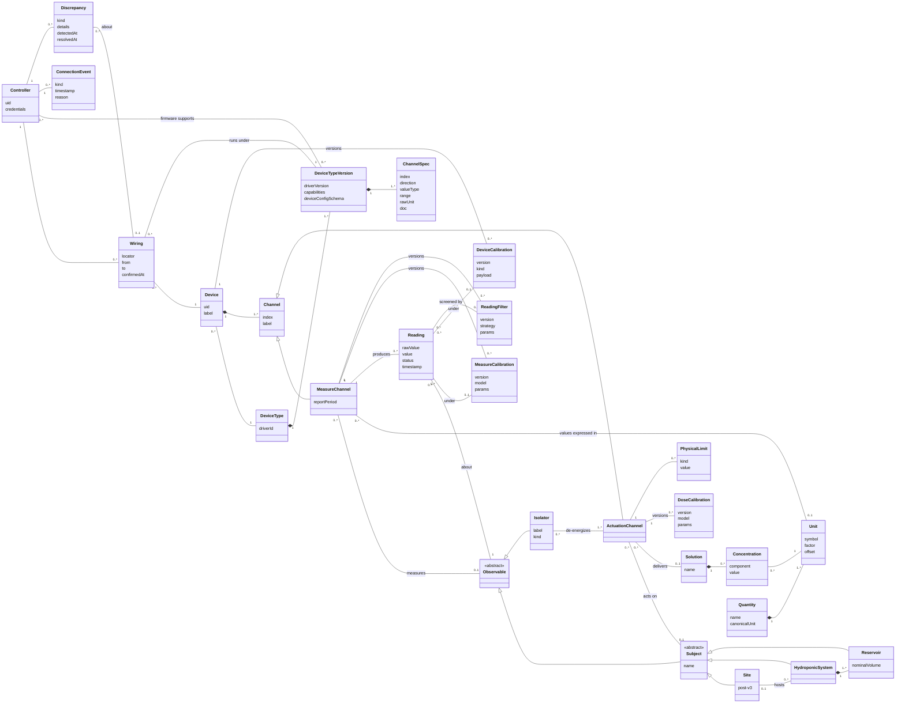
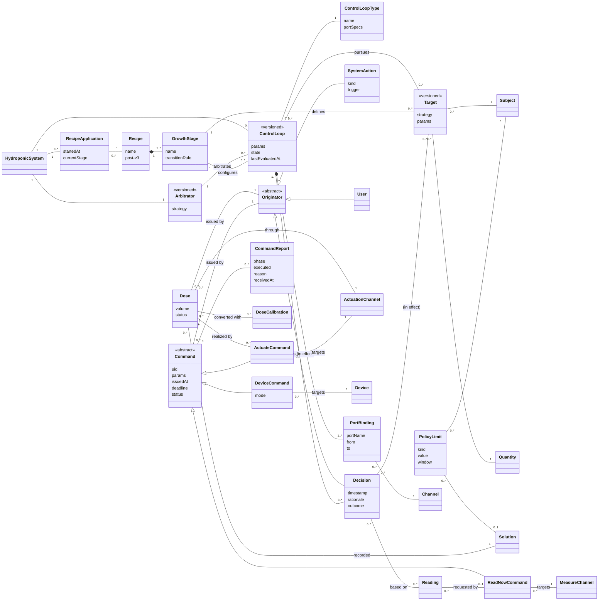
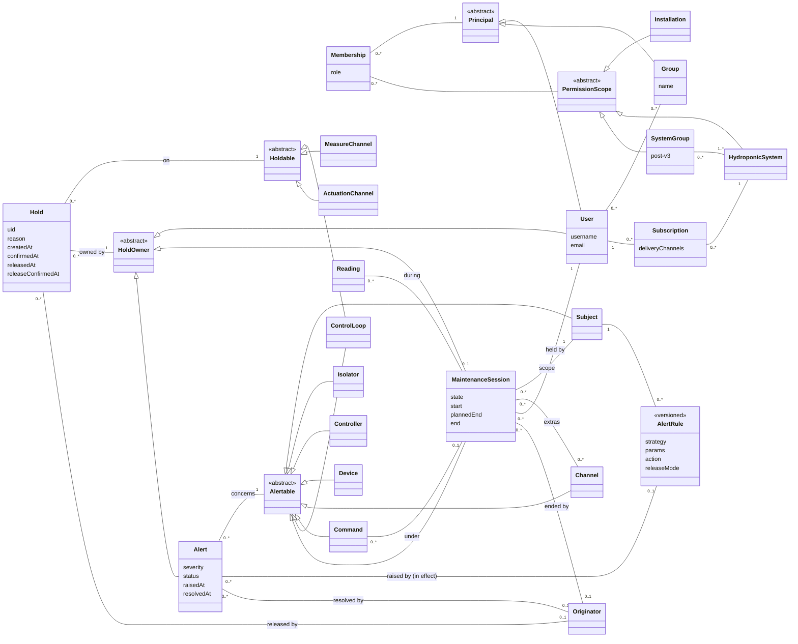
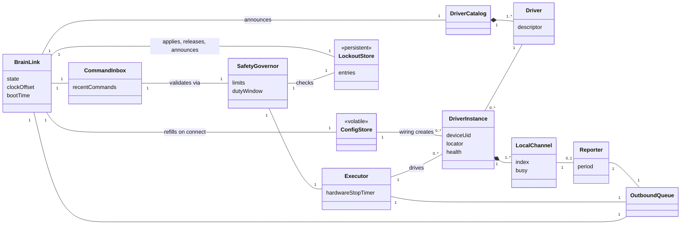
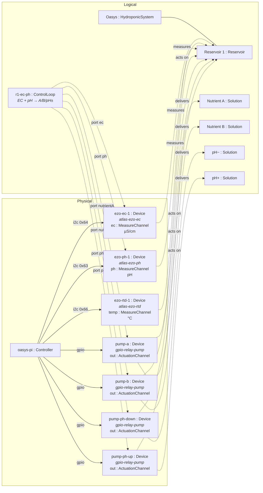

# AquaDash v3 — Conceptual model (diagrams)

| Author         | Version | Date       | Based on                                                                                                                     |
| -------------- | ------- | ---------- | ---------------------------------------------------------------------------------------------------------------------------- |
| Thierry Poulin | _v0.1_  | 2026-11-18 | [Vision v1.1](aquadash-v3.0.0-vision.md)                                                                                     |
| Thierry Poulin | _v0.2_  | 2026-11-19 | Holds, subject-scoped maintenance, isolators, controller lockouts                                                            |
| Thierry Poulin | _v0.3_  | 2026-11-20 | Observables, identity vs. version, split calibrations, command subtypes, alert-owned stops, permission scopes, Oasys example |

These are **conceptual** diagrams: domain concepts, their main attributes and their associations. They are not database tables or code classes. The glossary, design decisions, lifecycle rules, triage of the original candidates and open questions are in the sister document [conceptual-model-notes.md](conceptual-model-notes.md).

The model has four views and one worked example:

- **A. Topology**: what exists physically and logically, and how the two connect.
- **B. Control and commands**: how readings become decisions, doses and commands.
- **C. People, safety and alerts**: who can do what, what can be stopped, and who gets told.
- **D. Controller side**: what runs on a controller. This is a separate model from the brain's.
- **E. Example: Oasys**: the concepts above, instantiated for our first system, and the drivers v3 needs.

Conventions:

- Concepts marked `post-v3` are modeled so that the architecture leaves room for them. v3.0.0 doesn't implement them.
- A class marked `<<versioned>>` stands for a stable **identity** plus a list of immutable **versions** (notes [§5](conceptual-model-notes.md#5-identity-and-versions)). Associations labeled `(in effect)` point to the version that was in effect at the time; all others point to the identity.
- `uid` is shown only where an identifier leaves the brain (Controller, Device, Command, Hold). Every concept has an identity.

---

## A. Topology

**Invariant:** only **Channel ↔ Observable** bindings and **calibrations** connect the physical side (Controller, Wiring, Device, DeviceType) to the logical side (Subject and below). Control logic never refers to a controller, a locator or a pin.

- An **Observable** is what a reading is about: a **Subject** (water, air, a system) or an **Isolator** (whether a power switch is open). A sensed Isolator is just a `bool` MeasureChannel bound to it. Its meaning comes from the binding, not from a special channel type.
- An **unbound** channel exists between device registration and binding, or after an unbind. It doesn't report periodically and produces no stored Readings. Its live value may be shown for commissioning.
- A MeasureChannel's Quantity is the one its Unit belongs to (derived). A Unit is required for numeric value types, and absent for `bool` and `bytes`.
- `Reading.status` (accepted / rejected / corrected) can't be read off `value` and `rawValue`, because `value` always goes through unit conversion and calibration. A rejected reading has no `value`.
- A Channel realizes the ChannelSpec at its `index` in the DeviceTypeVersion of its current Wiring. A device may be wired only under a version **compatible** with its channels (same ChannelSpecs by index, direction and value type).
- `Wiring.confirmedAt` is empty while a wiring change is pending, until the controller confirms it. Commands to a channel whose wiring is pending are refused.
- An **Isolator** is a physical switch that cuts power to one or more actuation channels. It has at most one sense channel. Without one, the Isolator is a checklist item.
- There are three calibrations: **MeasureCalibration** (raw → value, brain-side), **DoseCalibration** (volume → command parameters, brain-side) and **DeviceCalibration** (stored on the device, opaque to the brain).

---

## B. Control and commands

- A Command always reaches one Device. For an **ActuateCommand** or a **ReadNowCommand**, that Device is the targeted channel's (derived). A **DeviceCommand** addresses a whole device; its `mode` is `configure` (replayable) or `procedure` (one-shot, never replayed).
- `Command.issuedAt` is in brain time. A controller refuses any command issued before its own last boot (notes D35).
- `CommandReport.phase` is `received`, `refused`, `completed` or `partial`. Reports may arrive late (after a reconnect). A controller runs one actuation per channel at a time and refuses a second with reason `busy`.
- `Dose.status` is `accepted` or `refused` (by a PolicyLimit, or by an isolated Isolator). An accepted Dose with `volume > 0` has at least one ActuateCommand; a refused one has none. `Dose.Solution` is recorded when the dose is issued, so a later change to the channel's Solution doesn't rewrite history.
- **Limits speak two languages.** A PolicyLimit counts physical amounts (mL of a Solution) and is checked on Doses, before conversion. A PhysicalLimit (view A) counts seconds, intensity and duty, and is checked on Commands by the controller.
- A **PortBinding** belongs to the loop's identity, with a time range, like Wiring. An input port binds a MeasureChannel, an output port an ActuationChannel. `ControlLoop.state` (dosing / mixing / measuring / deciding) and `lastEvaluatedAt` also belong to the identity; `params` belong to versions.
- A **Decision** is recorded only when the loop acts: `outcome` is `dose` or `abstain` (with an alert). "Nothing to do" is not recorded; `lastEvaluatedAt` shows the loop is alive.
- A ControlLoop is **paused** when it has an unreleased Hold, or when any channel bound to one of its ports has one (view C). This is derived, not stored.
- A **SystemAction** is something the brain does on its own: escalating an overdue session, replaying `configure` on reconnect, an AlertRule raising an Alert. Its `trigger` names what caused it (a session, a ConnectionEvent, an AlertRule version).
- **v3 scope:** several ControlLoops per system (at least one per reservoir on Oasys), each of type EC → A/B or EC + pH → A/B/pH±. No two loops share an output channel. The Arbitrator is trivial and Targets are static.

---

## C. People, safety and alerts

- A **Membership** gives a role on a PermissionScope: the whole **Installation** (this AquaDash deployment; an admin), one HydroponicSystem (a manager, an operator…), or, post-v3, a **SystemGroup** (the five Bourgeons).
- A Holdable is **active** if and only if it has no unreleased Hold. Holds stack. Each owner releases only its own, except that an admin may release any Hold; `released by` records who did.
- **A maintenance session is for physical work** ("someone is at the hardware"); a plain Hold is for configuration work. While a session holds something, only its holder may change it; while two sessions hold it, nobody may. This is derived from the owner, not stored.
- `Hold.confirmedAt` and `Hold.releaseConfirmedAt` apply to Holds on ActuationChannels: they are set once the controller has durably stored, or durably removed, its lockout.
- **What an owner holds** depends on its kind. A MaintenanceSession holds every MeasureChannel and ActuationChannel bound to its scope, plus its extras. An Alert raised by a rule whose `action` is an emergency stop holds the ActuationChannels and ControlLoops of the rule's Subject, never MeasureChannels. Channels bound to an Isolator are never held.
- **Resolving an Alert releases the Holds it owns.** By default a person resolves it (`releaseMode = manual`). A rule may instead release automatically once its condition clears, which requires hysteresis (e.g. stop below 20 %, release above 25 %).
- `MaintenanceSession.state`: `requested` → `locked` (all actuation Holds confirmed) → `isolated` (all relevant Isolators confirmed; "safe to work") → `releasing` → `ended`. When the scope gains hardware, or a held device moves to another controller, an `isolated` or `locked` session goes back to `requested` until the new Holds and Isolators are confirmed.
- **Session invariant:** a session's Holds only accumulate. At every moment they include resolve(scope) ∪ extras, and none is released before the session ends.
- A session is **overdue** once `plannedEnd` has passed (derived). Overdue sessions are escalated (holder → managers of the systems in scope → Installation admins), never ended automatically.

The rules behind these notes are in [notes §4](conceptual-model-notes.md#4-holds-maintenance-and-mutations).

---

## D. Controller side

- **LockoutStore** holds one entry per Hold on an ActuationChannel pushed by the brain, keyed by the Hold's uid and its owner. It is loaded at boot, before the controller connects. Applying an entry aborts any actuation running on that channel. Adding and removing an entry are both acknowledged only once durable.
- After boot, the controller refuses **all** commands until its configuration has synced. The sync gives it brain time, from which it computes `bootTime` and evaluates deadlines; it then refuses any command whose `issuedAt` is before `bootTime`.
- **CommandInbox** keeps each command it has seen, with its report, until the command's deadline passes. A resent command id gets the original report back instead of running again. This needs no persistence: after a reboot, the `bootTime` rule refuses every command the controller could have seen.
- A command reaches a DriverInstance by `deviceUid`, plus a LocalChannel `index` for actuate and read-now commands. A LocalChannel runs one actuation at a time.
- Holds on MeasureChannels arrive as reporting suspensions in the ConfigStore. They are not persisted.
- The full contract is in [notes §4.4](conceptual-model-notes.md#44-controller-lockout-contract).

---

## E. Example: Oasys

This is an instance diagram: each box is one _thing_, written `name : Concept`. Solid arrows are physical (Wiring), dashed arrows are logical (bindings and port bindings). It shows one reservoir; the others repeat the same pattern with their own devices and loop. The italic line under a device is its **DeviceType**, i.e. the concrete driver that runs it (`driverId`); under the loop, it is its ControlLoopType.

What the brain-side model calls a "pump" or an "EC sensor" is a **role**, not a class: a pump is an ActuationChannel that delivers a Solution and has a DoseCalibration; an EC sensor is a MeasureChannel whose Unit belongs to the Quantity EC. Those roles are exactly what a ControlLoopType's ports require, and any driver that fills them works. A driver fills the pH role by **declaring** a float channel in a pH unit, not by implementing a "pH sensor" interface: new kinds of sensors then need a new driver, never new code in the brain or the controller framework.

**The driver contract is "implement what you declare":**

| Part                                                                                        | Required when                              |
| ------------------------------------------------------------------------------------------- | ------------------------------------------ |
| Describe itself: ChannelSpecs, capabilities, calibration and configuration schema           | always                                     |
| Read a channel                                                                              | for each **measure** channel it declares   |
| Actuate a channel, with a stop that doesn't depend on the code that started it (notes §7.2) | for each **actuation** channel it declares |
| Device operations (`configure`, `procedure`)                                                | for each operation its schema declares     |

So `atlas-ezo-ph` describes itself, reads its one channel and runs its calibration procedures; `gpio-relay-pump` describes itself and actuates, with no device operations; a mixed board does both. The controller routes each command by its target channel's direction, so it never asks a sensor driver to actuate, which mirrors the Command subtypes in view B. Device-specific operations, such as Atlas calibration, are the one place drivers differ in behavior, and they reach the brain only as a schema the UI renders as a generic form.

**Drivers the Pi controller needs for v3:**

| Driver (DeviceType) | Hardware                        | Locator  | Channels                                | Device-side calibration      | Brain-side calibration                           | Status   |
| ------------------- | ------------------------------- | -------- | --------------------------------------- | ---------------------------- | ------------------------------------------------ | -------- |
| `atlas-ezo-ec`      | Atlas Scientific EZO-EC         | I2C 0x64 | `ec`: float, µS/cm                      | `procedure` (dry, low, high) | none needed                                      | Working  |
| `atlas-ezo-ph`      | Atlas Scientific EZO-pH         | I2C 0x63 | `ph`: float, pH                         | `procedure` (mid, low, high) | none needed                                      | Working  |
| `atlas-ezo-rtd`     | Atlas Scientific EZO-RTD        | I2C 0x66 | `temp`: float, °C                       | `procedure` (single point)   | none needed                                      | Working  |
| `gpio-relay-pump`   | Peristaltic pump behind a relay | GPIO pin | `out`: actuation, duration only, on/off | none                         | DoseCalibration: linear, mL/s, measured on bench | Untested |

- The relay is too slow for software PWM, so a pump runs at full speed or not at all: an ActuateCommand carries only a duration, and the driver's capabilities declare no intensity.
- Whether our EZO firmware supports `Export`/`Import` is still to check. If it does, that blob is a `replayable` DeviceCalibration; otherwise EZO calibration is `procedure` only, recorded in the brain as a log entry (when, which points, by whom) and never resent.
- The I2C addresses are those in today's [constants.py](../../Sensors/services/constants.py).
- Today's code also has a DFRobot SEN0311 ultrasonic level sensor. It isn't part of v3.0.0. It reports a distance, and turning that into a level or volume is a derived channel ([notes §6](conceptual-model-notes.md#6-modeled-but-not-in-v3)).
