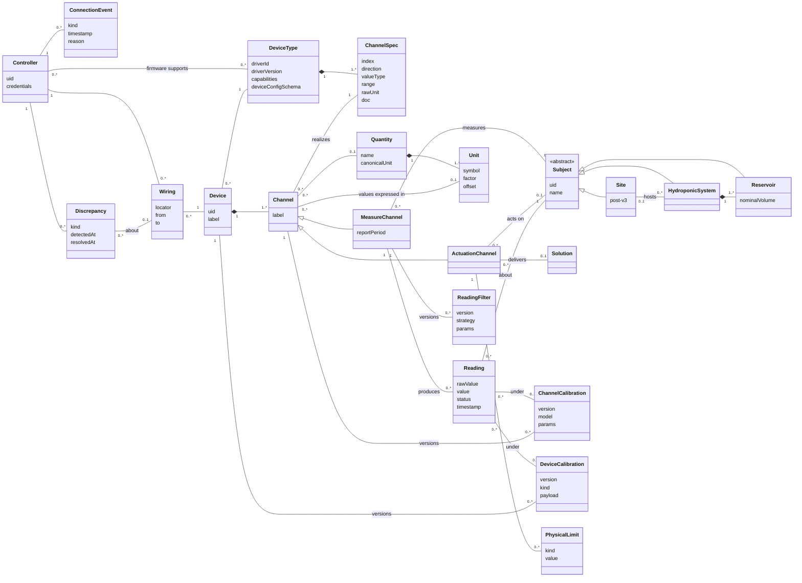
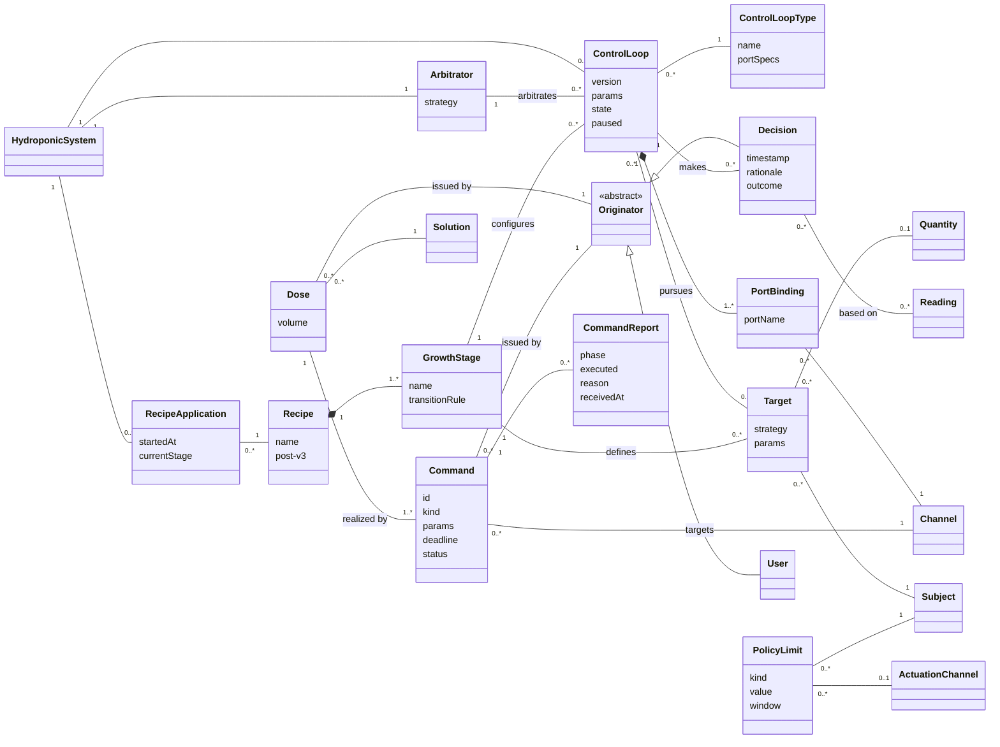
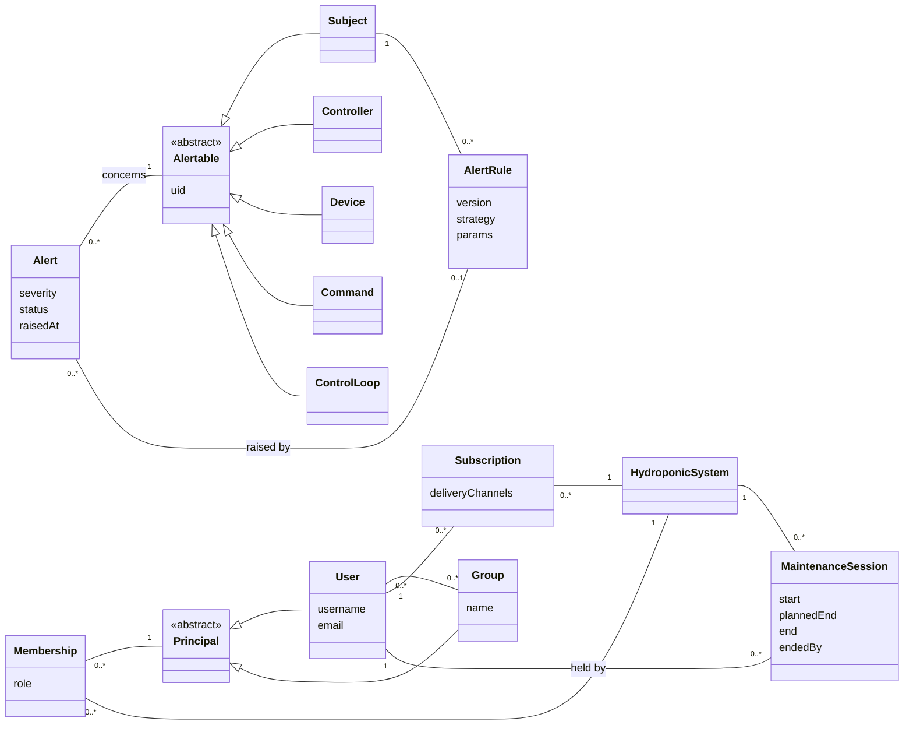
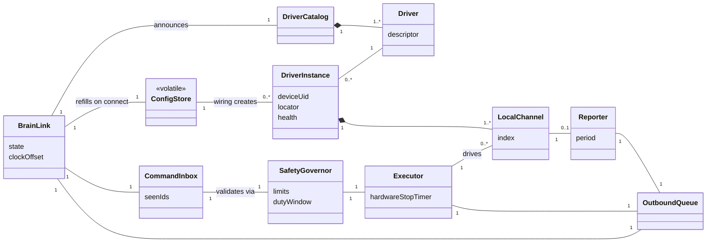

# AquaDash v3 — Conceptual model (diagrams)

| Version | Date       | Based on                                 |
| ------- | ---------- | ---------------------------------------- |
| _v0.1_  | 2026-11-18 | [Vision v1.1](aquadash-v3.0.0-vision.md) |

These are **conceptual** diagrams: domain concepts, their main attributes and their associations. They are not database tables or code classes. The glossary, design decisions, triage of the original candidates and open questions are in the sister document [conceptual-model-notes.md](conceptual-model-notes.md).

The model has four views:

- **A. Topology**: what exists physically and logically, and how the two connect.
- **B. Control and commands**: how readings become decisions, doses and commands.
- **C. People, safety and alerts**: who can do what, and who gets told.
- **D. Controller side**: what runs on a controller. This is a separate model from the brain's.

Concepts marked `post-v3` are modeled so that the architecture leaves room for them. v3.0.0 doesn't implement them.

---

## A. Topology

**Invariant:** only **Channel ↔ Subject** bindings and **calibrations** connect the physical side (Controller, Wiring, Device, DeviceType) to the logical side (Subject and below). Control logic never refers to a controller, a locator or a pin.

---

## B. Control and commands

- `Command.kind` is one of: `actuate`, `readNow`, `configure` (replayable) or `procedure` (one-shot, never replayed). A `configure` or `procedure` command addresses the whole Device rather than a single channel.
- `CommandReport.phase` is `received`, `refused`, `completed` or `partial`. Reports may arrive late (after a reconnect).
- **v3 scope:** one ControlLoop per system (EC → A/B, or EC + pH → A/B/pH±), a trivial Arbitrator, and static Targets.

---

## C. People, safety and alerts

---

## D. Controller side

